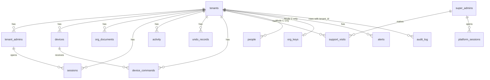
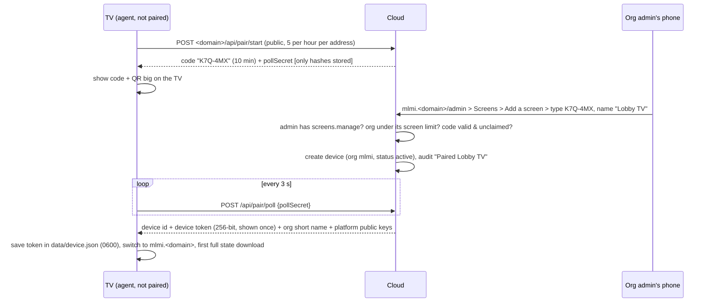

# TachTach Screens as a hosted service: the plan

Status: **plan only, nothing built yet** (rewritten 2026-10-25 from the owner's first sketch).
Audience: the owner (non-developer) first, then whoever builds it. Every technical term is explained the first time it appears, and the glossary in section 2 has them all.

This plan **builds on** the single-school cloud design that was already worked out in `docs/superpowers/specs/2026-10-13-vercel-hybrid-architecture-design.md` (the "hybrid spec": 31-row inventory of what can run on Vercel, Supabase schema sketch, pairing flow, phased cut-over). That spec said "no multi-school support" on purpose. This plan adds what is needed for **up to about 5 organisations**, the owner's dashboard, the two choices for student names, and support access. Where the hybrid spec already answers something well, this plan points to it rather than repeating it.

---

## 0. One-page summary

### What we are building
One cloud service, still called **TachTach Screens**, that runs the admin website and the "brain" (rules, schedules, uploads, feeds) for several organisations ("orgs": schools, yeshivos, shuls). Each org has its own name, its own web address, its own people and its own screens. Each school's Raspberry Pi becomes a **player**: it shows the TV, keeps a copy of everything on its own disk so the TV keeps going when the internet drops, and (if the org chooses) keeps the students' names to itself. The owner gets a **platform dashboard** showing every org and every screen.

### Decisions already made by the owner

| # | Decision | What it means in this plan |
|---|---|---|
| D1 | Brand stays **TachTach Screens**; each org gets its own name and a short name for web addresses | Each org lives at `<short>.<platform-domain>`, for example `mlmi.<platform-domain>/admin`. The org's name, logo and colours show everywhere inside. |
| D2 | Orgs start under the TachTach umbrella and can later move to their own domain and then to their own hosting | Three stages, no rebuild between them: **Hosted** -> **Custom domain** (`screens.theirschool.org`) -> **Self-hosted** (their own Pi/server runs the whole app, as MLMI does today). One codebase, one data format. |
| D3 | Free or cheap, for friends and orgs the owner knows; realistically **at most ~5 orgs** | Optimise for low cost, low maintenance and simplicity. No self-signup, no billing, no scale tricks. Section 24 lists what we will **not** build. |
| D4 | Student names (roster, birthdays, chazan) stay local: **each org chooses** | **Mode L "names stay on our screen box"**: the cloud never receives them. **Mode C "names in the cloud, encrypted"**: stored encrypted with a key per org. Section 9 designs both and lists what stops working in Mode L when the Pi is off. |
| D5 | Hosting on **Vercel + Supabase** (Postgres database, file storage, realtime) | One Vercel project, one production Supabase project (plus one free staging project). |
| D6 | Reuse the `saas-server` schema (tenants, devices, super_admins, audit_log) | Those four tables become the platform core. Section 6 lists exactly what exists, what changes and what is new. |
| D7 | Sign-in stays: invite link + password + optional 2-step; Google sign-in later | Today's sign-in code moves to the cloud almost unchanged. Section 14 shows where Google plugs in. |
| D8 | The owner (platform admin) gets **full access to any org, always logged**, log visible to the org | "Support visits": time-limited, reason required, every action written to a log the org can read, org admins notified. Section 16 covers the privacy side honestly. |
| D9 | The admin must work when the Pi is down; the owner gets a dashboard of all orgs | Cloud brain + thin Pi player with an on-disk cache. Dashboard: online status, version, last seen, health, alerts, feature flags, suspend / export / delete. |

### Recommendations this plan makes (owner to confirm)

| # | Recommendation | Why |
|---|---|---|
| R1 | The cloud runs **today's TachTach server code** (plain JavaScript, Express) with a database "storage adapter", **not** a rewrite in `saas-server`'s TypeScript. `saas-server` contributes its database schema and migrations; `saas-admin` (still an untouched starter template) is not used. | The 1,300-line `api.js` and everything around it already work and are tested (~540 tests). A rewrite would take months and re-introduce fixed bugs. |
| R2 | One database for all orgs, with **four layers** that keep orgs apart (address -> org, session tied to org, every store call needs an org, Postgres row-level security), plus an **automated cross-org test** that tries every route. | A separate database per org is stronger but costs money and maintenance x5. |
| R3 | The Pi player is **today's app in a "player mode"** at first (same repo, same `deploy/update.sh` path), later slimmed. Chromium keeps loading from the Pi itself (`https://127.0.0.1:3443`), and the Pi keeps the last good copy of everything on disk. | Survives a reboot with no internet (a browser-only cache does not reliably). Reuses the existing local HTTPS, update units and roster/chazan code. Mode L needs a program on the Pi anyway. |
| R4 | Screens learn about changes by a **cheap check every 60 seconds** ("anything new?" answered "no" most of the time) plus an **instant nudge** over Supabase Realtime. The nudge carries no content. | Boring and robust. The minute check also tells the dashboard "this screen is alive". |
| R5 | MLMI starts in **Mode L** (names stay on its Pi), because that is exactly where they are today. | Lowest risk for the first migration: `roster.json` and `chazan.json` simply do not move. |
| R6 | Free tiers while building and while MLMI is the only org; switch to **Vercel Pro + Supabase Pro (about $45-50/month total)** the day a second org's real data arrives. | Free Supabase has no backups and pauses when idle; Vercel's free plan is for non-commercial use only. |
| R7 | Pis follow a **`stable` branch** that the owner moves forward only after MLMI has run a version for a few days. | MLMI is the "canary": a bad update hits one school, not five. |
| R8 | Build nothing for billing, self-signup, single sign-on, per-screen different content, Windows players or end-to-end encryption until someone actually asks. | D3. (2026-10-26: the owner asked for Windows; a single-school Windows install now exists, `deploy/windows/`. The cloud-era Windows player is a thin browser player, see 12.7.) |

### Roadmap at a glance
Sizes: **S** = a few days of focused work, **M** = about 1-2 weeks, **L** = about 3-4 weeks. Calendar time depends on how many sessions per week the owner runs; the MLMI soak periods are calendar time no matter what.

| Phase | What | Size | Done when |
|---|---|---|---|
| P0 | Decisions + accounts (domain, Vercel, Supabase, terms text) | S (mostly owner) | Open questions in section 26 answered; accounts exist |
| P1 | Make the current app "org-aware" (still one org, still files, still on the Pi) + export/import of a whole org | M | All tests pass; export -> import gives identical data; MLMI unaffected for 1 week |
| P2 | Cloud foundation: database schema, storage adapter, sign-in in the cloud, isolation tests | L | Two test orgs in staging; cross-org test suite green; admin works with no Pi at all |
| P3 | Player mode + pairing + device tokens + polling/nudge + on-disk cache + Mode L names on the Pi | L | Soak tests pass on a spare Pi (internet unplugged 2 h, cold boot offline, revoke, nightly restart) |
| P4 | Move MLMI to the cloud, zero downtime, rollback rehearsed | M | MLMI on the cloud for 2 weeks; one rollback rehearsed on a copy |
| P5 | Platform dashboard, support visits, alerts, backups | M-L | Owner gets an alert within 15 min of unplugging a test Pi; a support visit shows up in the org's log |
| P6 | First friendly outside org | M | Onboarded with the runbook (section 20); live 2 weeks |
| P7 | Mode C (names in the cloud, encrypted), only when an org asks | M | Encryption tests; switch L<->C works both ways |
| P8 | Custom domains | S | One org on its own domain |
| P9 | Self-host "graduation" (export -> their own box, updates channel) | M | A test org moved out and back |
| P10 | Google sign-in | S-M | Google sign-in works next to passwords |

### Cost in one line
About **$45-50 a month for all 5 orgs together** (Vercel Pro ~$20 + Supabase Pro ~$25 + a domain ~$15/year), roughly $10 per org per month. Hardware (a Pi kit, ~$120-160) is per screen, paid by the org. Free is possible during the build, with real downsides (section 21).

### Top 5 risks (full register in section 25)
1. **A bug lets one org see another org's data.** Mitigation: four isolation layers + the automated cross-org test on every change.
2. **The owner's own login is stolen** (it can open every org). Mitigation: separate platform login on its own address, mandatory 2-step (later a passkey), short sessions, alert on every platform sign-in.
3. **A bad update breaks every school's TV at once.** Mitigation: MLMI canary + `stable` branch + automatic rollback (already built in `deploy/run-update.sh`) + the TV keeps its cached content.
4. **Mode L names are lost when a Pi's SD card dies.** Mitigation: optional sealed backup the cloud cannot read (opened only with the org's recovery code).
5. **Privacy expectations** about student names and owner access. Mitigation: per-org names mode, org-visible support log, plain-English terms before any org's data arrives.

---

## 1. How to read this document

- Sections 3-5: the big picture (today, the target, web addresses).
- Sections 6-8: the data (tables, keeping orgs apart, where every current file and module goes).
- Section 9: student names, both modes.
- Sections 10-13: screens (realtime, offline, pairing, the Pi player, per-org features).
- Sections 14-17: people and safety (sign-in, dashboard, support access, security, privacy law).
- Sections 18-23: running it (monitoring, MLMI migration, onboarding, cost, testing, phases).
- Sections 24-26: what not to build, risks, open questions.

Words in **bold** are decisions or rules. "Must" means the plan fails without it; "should" means strongly recommended.

---

## 2. Glossary (plain English)

| Word | Meaning here |
|---|---|
| **Org** (also "tenant" in the code) | One customer: a school, yeshiva or shul. `saas-server` calls it a *tenant*; this document says *org*. |
| **Platform** | The whole TachTach Screens service that hosts all orgs. |
| **Platform owner** / **super admin** | You. Can see and manage every org. `saas-server` calls this a *super admin*. |
| **Org admin / editor** | People inside one org, the same roles as today (Admin, Full editor, Messages only, View only). |
| **Cloud brain** | The part that runs on Vercel + Supabase: admin website, rules, database, files, scheduled jobs. |
| **Player** | Whatever shows the TV. Normally the school's Pi with Chromium. Could also be any browser on a stick PC. |
| **Agent** | The small program on the Pi that keeps the player going: caches content, talks to the cloud, holds Mode L names, does updates. |
| **Vercel** | Hosting for the website and the server code. It runs the code only when a request comes in ("serverless functions"); there is no always-on process. |
| **Supabase** | Hosted Postgres database + file storage + realtime messaging. |
| **Postgres** | The database. Tables with rows, like spreadsheets with strict rules. |
| **RLS (row-level security)** | A Postgres feature: the database itself refuses to return rows that belong to a different org, even if the app code has a bug. |
| **Document** | Today every `data/*.json` file is one "document". In the cloud each org has the same documents, stored as rows. |
| **Device token** | A long random secret that proves "I am screen X of org Y". Like a house key for one screen; can be cancelled ("revoked"). |
| **Pairing** | Connecting a new screen to an org: the TV shows a code, an org admin types it into the admin. |
| **Nudge** (poke) | A tiny realtime message that says only "something changed, ask again". It carries no content, so a fake nudge does no harm. |
| **ETag / 304** | A fingerprint of the current content. The screen says "I have version abc"; the cloud answers "nothing new" (304) in a few bytes. |
| **Mode L / Mode C** | The two choices for student names (section 9): **L**ocal on the Pi only, or **C**loud encrypted. |
| **KEK / DEK** | Encryption keys. The DEK (data key) locks one org's names; the KEK (key-encrypting key) locks the DEKs. |
| **Support visit** | The platform owner opening an org's admin, time-limited and logged. |
| **Canary** | The first install that gets every update (MLMI), so problems show up there first. |
| **Soak test** | Running something for real for days to see what breaks. |
| **Staging** | A copy of the cloud with fake data, used for testing before real orgs see a change. |

---

## 3. Where we are today (facts checked in the code)

### 3.1 TachTach Screens (the product)
- **One Raspberry Pi 5 per school does everything**: Express server (`server.js` -> `src/server/app.js`), JSON files in `data/`, every fetcher (`src/fetchers/*`), the three-track scheduler, SSE live updates (`src/server/sse.js`), uploads processed with sharp, PDF pages via poppler (`src/server/pdf.js`), the admin website, and the Chromium kiosk pointed at `https://127.0.0.1:3443/screen` (local HTTPS, `src/server/localTls.js`, needed so Charidy can be framed).
- Remote access goes through a Cloudflare Tunnel to the Pi. If the Pi is off, the admin is gone too.
- Security model (CLAUDE.md "Non-negotiable rules"): fail closed; `localhostOnly`/`localhostOrAuth` trust only a loopback peer with no proxy headers; CSRF double-submit; logins in `data/users.json` with every token stored only as a hash; mandatory 2-step for admins; deliberate public exceptions only `GET /` and the opt-in live view (`src/server/live.js`).
- Updates: `deploy/update.sh` (`git pull --ff-only` + `npm ci` + `npm run build`), started from the admin through a root-owned systemd path unit and wrapper (`deploy/run-update.sh`) that never runs files the app's user can edit, with automatic rollback. Units change only through a manual `update.sh` run. Details: ARCHITECTURE.md "Software update from the website".
- ~66 test files, about 540 tests, run with `node --test`. **There is no CI** (no `.github/` folder): tests run when an agent or the owner runs them.
- Hard-coded single-school assumptions are few: no "MLMI" string in `src/` (only in `deploy/pi-combined-setup.md`). Everything school-specific (name, logo, location, timezone) is already in `settings.json`. Good news for multi-org.

### 3.2 `saas-server/` and `saas-admin/` (reality check)
CLAUDE.md describes these as the separate "Mivtzah" SaaS. What is **actually in this repo** is the start of the **"TachTach SaaS Plan 1: Foundation"** from 2026-05 (`docs/superpowers/plans/2026-05-07-tachtach-saas-plan1-foundation.md`):

| Part | What exists | What does not exist |
|---|---|---|
| `saas-server/src/db/schema.ts` + `drizzle/migrations/0000_curvy_sage.sql` | Tables `tenants`, `tenant_admins`, `devices`, `super_admins`, `audit_log` | No content tables, no sessions table of its own (uses `connect-pg-simple`'s `session`), no RLS policies, no `tenant_id` on `audit_log` |
| `saas-server/src/app.ts` | Express + helmet + CORS + `express-session` (4-hour cookies) in Postgres; `resolveSessionSecret` refuses to start in production without a secret | No routes except `GET /health`. No login, no tenant middleware, no audit helper (the plan's `middleware/`, `services/` folders were never written) |
| `saas-server/tests/` | A schema insert/read test and a session-secret test | No isolation tests |
| `saas-admin/` | The untouched Vite + React + TypeScript starter page (counter button) | Nothing TachTach-specific |

The Mivtzah leaderboard that TachTach shows comes from a **different** Supabase project (`MIVTZAH_SUPABASE_URL` / `MIVTZAH_SUPABASE_ANON_KEY` in `src/fetchers/mivtzah.js`), and the Mivtzah `/live` page the embed slide frames is hosted elsewhere. **Open question Q4**: is anything from `saas-server` deployed anywhere today? This plan assumes **no**, and that TachTach gets its own new Supabase project. If `saas-server`'s database is live for Mivtzah, we copy the schema and do not share the database.

### 3.3 What already helps
- The kiosk, admin and the rules in `src/shared/*` (announcements, chazan, roster, schedules, freeze, kiddush levana, takeovers) are **pure functions that run in the browser from one state object**. They move to the cloud almost unchanged; what changes is where the state lives and how it is pushed.
- The **data pack** work in progress: local, offline calculation of the Hebrew calendar (`src/shared/hebrewCalendar.js`), zmanim (`zmanim.js`, `solar.js`), parsha/holidays (`torahReading.js`), Tehillim and Pirkei Avos cycles. There is no `docs/DATA-PACK-PLAN.md` yet. This matters a lot for the cloud: less fetching, and the TV can work out today's zmanim even offline (section 13.9).
- Token hashing, capability-based roles, invite/sign-in links, lockouts, the activity log and undo are already designed per person and per change; they need an `org_id`, not a redesign.
- The kiosk already survives missed live updates by re-fetching the full state, so "nudge + re-fetch" is a small change (hybrid spec, end of section 1).

---

## 4. Target architecture

### 4.1 The picture

```
                          +---------------------------- Vercel (one project) -----------------------------+
 Phones / laptops         |  www.<domain>             public homepage (static, no data)                   |
 (org admins, editors) ---|  <short>.<domain>         org admin /admin, /login, /api/*, live view /live    |
                          |                           player API /api/device/* (device token)              |
 You (platform owner) ----|  platform.<domain>        platform dashboard /platform (own login, 2-step)     |
                          |  /api/cron/*              scheduled work, called by Supabase pg_cron           |
                          +-------------------------------+-----------------------------------------------+
                                                          | SQL (app role, RLS on)       | file URLs
                                                          v                              v
                          +--------------------------- Supabase (production project) ------------------------+
                          | Postgres: orgs (tenants), users, sessions, documents, devices, audit_log, ...     |
                          | Storage: org/<org_id>/uploads, fonts, google-photos, pdf pages                    |
                          | Realtime: content-free nudges per org                                              |
                          | pg_cron: every 5 min -> /api/cron/tick (RSS, photos, fetches, cleanup, alerts)     |
                          +----------------------------------------------+-------------------------------------+
                                                                         ^  HTTPS: "anything new?" every 60 s
                                                                         |  + nudge over a WebSocket
   School building                                                       |
   +---------------------------------------------------------------------+---------------------+
   |  Raspberry Pi 5 (player)                                                                   |
   |   Agent (Node, systemd, runs as the app's user)                                           |
   |     - fetches state + files from the cloud with the device token, keeps them on disk       |
   |     - serves the kiosk at https://127.0.0.1:3443 (local HTTPS, as today)                   |
   |     - Mode L: holds roster + chazan locally, merges names into what the TV sees            |
   |     - heartbeat, health facts, screen commands, software updates (existing root path unit) |
   |   Chromium kiosk -> https://127.0.0.1:3443/screen   (same kiosk code as today)             |
   |   Optional: cloudflared -> "People page" for Mode L editing (section 9.4)                  |
   +-------------------------------------------------------------------------------------------+
```

### 4.2 The pieces and their jobs

| Piece | Job | Built from |
|---|---|---|
| **Cloud app** (Vercel function) | Admin website and API for every org, sign-in, live view, player API, platform dashboard, scheduled jobs | Today's `src/server/*` with a database storage adapter and an org context; new `src/server/platform/*` routes |
| **Database** (Supabase Postgres) | Everything that is in `data/*.json` today, per org, plus platform tables | `saas-server` schema, extended (section 6) |
| **File storage** (Supabase Storage) | Uploads, fonts, Google Photos copies, PDF page images, per org | Replaces `data/uploads`, `data/fonts`, `data/google-photos` |
| **Realtime** (Supabase) | "Something changed" nudges to screens and open previews | Replaces SSE fan-out (`src/server/sse.js`) for the cloud |
| **Scheduled jobs** (pg_cron + `/api/cron/tick`) | Feeds, photo sync, cleanup, alerts, per org, when due | Replaces the in-process timers (`scheduler.js`, `rss-scheduler.js`, etc.) |
| **Agent** (on the Pi) | Keep the TV running and up to date; Mode L names; updates | Today's app started with `TT_MODE=player` (section 12) |
| **Kiosk** (in Chromium) | Draw the screen | Unchanged `src/screen/*` |
| **Admin** (in a phone/laptop browser) | Manage one org | Unchanged `src/admin/*` plus a "Screens" section and a "Support visits" card |
| **Platform dashboard** | You manage all orgs | New section; reuses the admin's UI kit (`src/admin/components/ui/`) |

### 4.3 Three key flows

**A. An editor posts a banner from her phone**
```mermaid
sequenceDiagram
  participant P as Editor's phone
  participant V as Cloud app (Vercel)
  participant DB as Supabase DB
  participant RT as Supabase Realtime
  participant A as Pi agent
  participant K as Kiosk (Chromium)
  P->>V: POST mlmi.<domain>/api/announcements (session cookie + CSRF)
  V->>V: org = mlmi (from address); session belongs to mlmi? caps allow?
  V->>DB: write document 'announcements' for org mlmi (version 41 -> 42)
  V->>DB: activity line "Posted a banner" (org mlmi)
  V->>RT: nudge on mlmi's channel {changed: ['announcements']}
  RT-->>A: nudge
  A->>V: GET /api/device/state  If-None-Match: v41
  V-->>A: 200 new state (v42)
  A->>A: save to disk, then tell the kiosk (local SSE, as today)
  A-->>K: announcements-update
  Note over A,V: If the nudge is lost, the 60 s check finds v42 anyway.
```

**B. The school's internet goes down mid-day**
The agent's checks fail; it keeps serving the last saved state and files from disk; the kiosk notices nothing (announcements still start and end on time because those rules run on the TV's own clock; zmanim come from the data pack). The cloud stops hearing heartbeats; after 10 minutes during school hours the dashboard shows the screen as offline and alerts are sent (section 18). When the internet returns, the next check picks up everything that was edited meanwhile.

**C. The Pi is unplugged**
The TV is dark, but `mlmi.<domain>/admin` works fully (it never touches the Pi). Edits wait in the database and appear when the Pi is back. Mode L only: names cannot be edited until the Pi is back (section 9.6).

---

## 5. Orgs, names and web addresses

### 5.1 Names
- Platform brand: **TachTach Screens** on the homepage, sign-in pages, the dashboard, emails/terms, and a small "TachTach Screens" credit in the admin footer.
- Each org: **display name** (e.g. "Machon L'Merkaz Yeshiva"), optional **Hebrew name**, **short name** (`mlmi`), logo, colours (the theme/font roles already allow per-org looks), timezone, location.
- **Short name rules**: 2-20 characters, lowercase letters, digits and `-`, starts with a letter. Reserved: `www`, `app`, `api`, `admin`, `platform`, `live`, `status`, `mail`, `people`, `people-*`, `staging`, `test`, `tts`, `tachtach`. Changing a short name later keeps the old address as a redirect for 90 days.
- **"tts"**: the owner floated a short name like "tts" in URLs. Options in **Q1**: a short platform domain (e.g. `<short>.tts.<tld>`), or `tts` as a reserved word. The plan writes `<domain>` throughout.

### 5.2 Addresses (one host per org, on purpose)

| Address | What | Why separate |
|---|---|---|
| `<domain>` / `www.<domain>` | Public homepage (static, no data), "Sign in" picks your org | Same rule as today's `homePage.js`: no data, no school details |
| `<short>.<domain>/admin` | That org's admin | **Cookies are per host**, so an org's session cookie is never even sent to another org's address. This is isolation layer 1 for free. |
| `<short>.<domain>/live/<word>` | That org's opt-in live view | Same as today, per org |
| `<short>.<domain>/api/device/*` | That org's screens talk here | Device token must match this org |
| `platform.<domain>` | Your dashboard | Your platform cookie never reaches org hosts and vice versa |
| `people-<short>.<domain>` | Mode L only: the Pi's People page through a tunnel (section 9.4) | Traffic goes to the Pi, never into the cloud app |
| `screens.theirschool.org` | Stage 2 custom domain, same app | Added per org in Vercel |

**Why not `app.<domain>/<short>`** (one host, org in the path)? Cookies, the live-view cookie, service workers and the browser's storage would all be shared between orgs on one host; every one of those would need careful per-path handling, and one slip leaks across orgs. Per-host costs nothing at 5 orgs: each subdomain is added in Vercel by hand (a wildcard `*.<domain>` would need Vercel to run the domain's DNS; not needed for 5 orgs).

### 5.3 The three stages for an org

| | Stage 1: Hosted | Stage 2: Custom domain | Stage 3: Self-hosted |
|---|---|---|---|
| Address | `<short>.<domain>` | `screens.theirschool.org` (old address redirects) | Their own (their Pi/tunnel or server) |
| Where data lives | Our Supabase | Our Supabase | Their box (`data/*.json` files, as MLMI today) |
| Who runs it | Owner | Owner | The org (owner may help) |
| Who pays hosting | Owner (or a small fee) | Same | The org |
| What the org does | Nothing technical | Adds one DNS record (CNAME) | Runs a Pi/server, presses "Update" |
| Moving there | - | Owner adds the domain in Vercel, org adds the CNAME, certificate is automatic; ~15 min + DNS wait | "Export org" (one zip) -> `import-org` on their box; their screens re-pair to the new address |
| Moving back | - | Remove domain | Export from their box -> import into a new hosted org |

**The rule that keeps stage 3 possible: one codebase, one data format.** The cloud build and the Pi/self-hosted build differ only in the storage adapter (Postgres vs files) and where sign-in data lives. The export format is literally the `data/*.json` files plus the upload folders, so a self-hosted install is just today's app with those files. Never write code that assumes one school, and never write cloud-only features into the data format without a file equivalent.

Updates in stage 3: their box follows the same `stable` branch as every Pi, through the same update button (section 12.6). Support for a self-hosted org is "best effort" and only with access they grant (they can create a login for the owner).

---

## 6. Data model

### 6.1 Approach
- **Documents first.** Today every `data/X.json` file is read whole, changed, and written whole. In the cloud, each org gets the same documents as rows in one table `org_documents (org_id, key, value, version)`. This makes the storage adapter a drop-in replacement for `src/server/storage.js` (`readJSON`/`writeJSON`), so the route code barely changes (the hybrid spec's reasoning, section 5, applies unchanged). Real tables only where needed: people, sessions, devices, audit, things that grow (activity, undo), and things machines write often (feed caches, photo manifests).
- **`saas-server` owns the schema.** All tables are defined in `saas-server/src/db/schema.ts` and created by Drizzle migrations in `saas-server/drizzle/migrations/` (one place, versioned, reviewable). The cloud app (plain JavaScript) talks to the database through a small SQL layer (`postgres` driver, the one `saas-server` already uses). Later, the schema folder can be renamed `cloud/db/`; that is cosmetic.
- **Every org-owned table has `org_id uuid not null references tenants(id) on delete cascade`, an index starting with `org_id`, RLS switched on, and the standard policy** (section 7.4). A test checks this for every table (section 7.6).

### 6.2 The four existing tables: keep, change, add

**`tenants` -> the org table.** Keep the name in the database (so the migrations stay valid); call it "org" in code and screens.

| Column | Status | Notes |
|---|---|---|
| `id` uuid | exists | |
| `name` | exists | Display name |
| `contact_email` | exists | Org owner's email, used only by the platform owner (we send no automatic email at first) |
| `status` | exists, **values change** | `active` / `suspended` / `deleting` / `deleted` (today default `active`) |
| `created_at` | exists | |
| `short_name` varchar(20) unique not null | **add** | `mlmi`; rules in 5.1 |
| `name_he` | **add** | Optional |
| `custom_domain` varchar(253) unique | **add** | Stage 2; null by default |
| `stage` varchar(12) | **add** | `hosted` / `custom_domain` / `self_hosted` (self-hosted orgs can stay listed for support notes) |
| `names_mode` varchar(1) not null default `L` | **add** | `L` or `C` (section 9) |
| `timezone` varchar(64) | **add** | Copy of `settings.location.timezone`, so the platform can do "school hours" maths without opening documents |
| `flags` jsonb not null default `{}` | **add** | Feature flags (section 15.4) |
| `limits` jsonb | **add** | e.g. `{maxScreens: 3, maxUsers: 25, storageMb: 2048}` |
| `suspended_at`, `suspend_reason`, `delete_after` | **add** | Suspend/delete flows (15.5) |
| `notify_support_visits` boolean default true | **add** | Section 16 |
| `release_channel` varchar(10) default `stable` | **add** | `canary` for MLMI |

**`tenant_admins` -> the people who sign in to an org.** Today's `data/users.json` record is richer than this table; this is the table that must grow most.

| Column | Status | Notes |
|---|---|---|
| `id`, `tenant_id`, `created_at`, `last_login` | exist | |
| `username` | exists, **constraint must change** | Today `unique` across the whole platform. Two orgs could both have "admin", so it must become **unique per org**: `unique (tenant_id, lower(username))` |
| `password_hash` | exists, **must become nullable** | Editors may sign in with sign-in links only (today's rule) |
| `force_password_reset` | exists | Keep; default should become `false` (invite links already make people choose a password) |
| `display_name`, `role` (`admin`/`editor`), `preset`, `overrides` jsonb | **add** | Same meaning as `users.json` (`src/shared/permissions.js`) |
| `totp_secret_enc` bytea, `totp_enabled` | **add** | 2-step secret, **encrypted** with the platform key (it is a secret, not just a hash) |
| `email` (nullable), `google_sub` (nullable, unique) | **add** | For Google sign-in later (section 14.3) |
| `disabled_at` | **add** | Removing a person keeps their id for history lines |

**`devices` -> screens.**

| Column | Status | Notes |
|---|---|---|
| `id`, `tenant_id`, `name`, `serial_number`, `status`, `created_at` | exist | `status`: `pending` / `active` / `revoked` / `wiped` |
| `screen_token_hash` | exists | SHA-256 of the current device token |
| `token_expires_at` | exists | Rolling, 90 days (section 11.4) |
| `last_heartbeat_at`, `last_heartbeat_ip` | exist | |
| `provisioning_secret` | exists | **Not used** by this design (pairing codes replace it); drop in a later migration or leave null |
| `encrypted_identity_key` | exists | Use for the device's own public key (section 11.2) |
| `prev_token_hash`, `prev_token_valid_until` | **add** | 24 h overlap during token rotation |
| `platform` (`pi`/`browser`/`windows`), `agent_version`, `app_version`, `bundle_version` | **add** | Shown on the dashboard |
| `last_state` jsonb | **add** | Current slide, paused/held, display size (today's `screenState.js` in memory) |
| `health` jsonb, `health_at` | **add** | Disk, temperature, clock sync, cache age (section 12.5) |
| `is_people_box` boolean | **add** | Mode L: the one screen that holds the names (section 9.4) |
| `revoked_at`, `revoked_by`, `revoke_reason` | **add** | |
| `paired_at`, `paired_by` | **add** | |

**`super_admins` -> platform owners.** Exists as needed: `username`, `email`, `password_hash`, `totp_secret`, `totp_enabled`. Changes: `totp_secret` should become `totp_secret_enc` (encrypted) and **`totp_enabled` must be forced true** (a check in code: a platform login without 2-step is refused). Add `last_login_at`, `last_login_ip`. Platform sessions go in `platform_sessions` (below), not in the org `sessions` table.

**`audit_log` -> the platform's permanent record.** Exists: `actor_type`, `actor_id`, `action`, `target_type`, `target_id`, `metadata`, `digest` (SHA-256), `created_at`, with the comment "append-only, NEVER update or delete".

| Change | Why |
|---|---|
| **add `tenant_id`** (nullable: platform-wide events have none) + index | So each org can be shown its own rows (D8). Today the table has no org column at all. |
| `actor_type` values: `system` / `tenant_admin` / `super_admin` / `support` / `device` | `support` = the owner during a support visit |
| **add `support_visit_id`** | Groups everything done in one visit |
| **add `prev_digest`**; `digest = sha256(prev_digest ‖ row contents)` | Makes it a chain: deleting or editing a row breaks every later digest, so tampering shows |
| **Enforce append-only in the database**: the app role gets `INSERT, SELECT` only; a trigger refuses `UPDATE`/`DELETE` | The comment alone does not stop a bug |
| **add `ip`, `user_agent_hint`** | For sign-in and support events |

What goes in `audit_log` vs the org's own activity log: see 6.4.

### 6.3 New tables

| Table | Key columns | Replaces | Notes |
|---|---|---|---|
| `org_documents` | `org_id`, `key`, `value` jsonb, `version` bigint, `updated_at`, `updated_by` | Most `data/*.json` files (section 8) | PK `(org_id, key)`. `version` goes up on every write (trigger); writes use "update where version = expected" and retry up to 3 times (hybrid spec 5, "Concurrency") |
| `org_document_history` | `org_id`, `key`, `value`, `version`, `changed_at` | `*.bak` files | Keep 30 days. **Excluded** for secret-bearing keys (`live` secret, etc.) |
| `sessions` | `token_hash` PK, `org_id`, `user_id`, `created_at`, `last_seen_at`, `expires_at`, `absolute_expires_at`, `ip`, `ua` | `users.json` `sessions[]` | Same 30-day rolling / 90-day absolute / max 20 rules; rewrite at most hourly (GOTCHAS "Session rewrite storm") |
| `trusted_devices` | `token_hash`, `org_id`, `user_id`, `expires_at` | `users.json` `trustedDevices[]` | 2-step "remember this device" |
| `auth_links` | `token_hash`, `org_id`, `user_id`, `kind` (`invite`/`signin`), `expires_at`, `used_at` | `users.json` `links[]` | Same 7-day / 60-min single-use rules |
| `preauth` | `token_hash`, `org_id`, `user_id`, `stage`, `expires_at` | `users.json` `preauth[]` | 5 min |
| `lockouts` | `key` (e.g. `ip:1.2.3.4`, `user:<org>:<name>|<ip>`), `count`, `locked_until`, `updated_at` | `users.json` `lockouts{}` + in-memory limiters | Shared by all function instances, so limits actually hold on Vercel |
| `platform_sessions` | `token_hash`, `super_admin_id`, `expires_at` (4 h, no rolling beyond 12 h), `ip` | - | Separate from org sessions |
| `support_visits` | `id`, `org_id`, `super_admin_id`, `reason`, `started_at`, `ends_at`, `ended_at`, `notified` | - | Section 16 |
| `activity` | `id`, `org_id`, `at`, `actor_id`, `actor_name`, `actor_kind` (`user`/`support`/`system`), `line`, `area`, `kind`, `undo_id` | `activity.json` | Keep the newest 500 per org or 180 days, whichever is more |
| `undo_records` | `id`, `org_id`, ... (today's `undo.json` shape) | `undo.json` | Same limits per org (100 records, 30 days, 120 KB per change) |
| `pairing_codes` | `code_hash`, `poll_secret_hash`, `expires_at`, `claimed_org_id`, `claimed_device_id`, `ip` | - | 10-minute codes (section 11) |
| `device_commands` | `id` bigserial, `org_id`, `device_id` (null = all org screens), `action`, `args`, `created_at`, `created_by`, `signature`, `done_at` | SSE `screen-command` | Section 10.4 |
| `push_subscriptions` | `id`, `org_id` or null (platform), `user_id`, `endpoint`, `keys`, `created_at` | `push.json` subscriptions | One platform VAPID key pair in an env secret |
| `rss_cache` | `org_id`, `feed_id`, `value`, `fetched_at` | `data/rss-cache/*` | Machine-written, kept out of `rss-feeds` doc (fewer write conflicts) |
| `google_photos` | `org_id`, `album_id`, `manifest`, `synced_at`, `status` | `data/google-photos/<id>.json` | Files in Storage |
| `shared_cache` | `key` (e.g. `zmanim:40.67,-73.94:2026-10-25`, `weather:11213:2026-10-25T14`), `value`, `fetched_at` | Parts of `cache.json` | **Not org data** (depends only on place/date), so shared by all orgs. No RLS needed, but only the app's server code can write it |
| `people` (Mode C only) | `org_id`, `person_id`, `enc` bytea (encrypted JSON: first, last, he, month, day), `updated_at` | `roster.json` `people[]` | Section 9.5 |
| `org_keys` (Mode C only) | `org_id`, `dek_wrapped` bytea, `kek_version`, `created_at`, `rotated_at` | - | Section 9.5 |
| `people_backups` (Mode L, optional) | `org_id`, `device_id`, `sealed` bytea, `created_at` | - | Sealed blob the cloud cannot open (9.4) |
| `alerts` | `id`, `org_id` (nullable), `device_id`, `rule`, `severity`, `opened_at`, `closed_at`, `last_notified_at`, `details` | - | Section 18 |
| `platform_settings` | `key`, `value` | - | e.g. current `stable` commit, maintenance banner |

### 6.4 Two logs, clearly separated

| | Org activity log (`activity`) | Platform audit log (`audit_log`) |
|---|---|---|
| Purpose | "Who did what" inside an org, in plain English, with Undo | Permanent record of platform-level and security events |
| Examples | "Posted a banner", "Changed the schedule for Friday" | Org created/suspended/exported/deleted, support visit started/ended, every page opened and change made during a support visit, device paired/revoked, platform sign-ins, names mode changed, update triggered, data export downloaded |
| Who can read | Org admins (as today; editors see their own + shared areas) | The owner sees all; **each org's admins see every row with their `tenant_id`** in Admin > History > "TachTach support & security" |
| Can be changed | Pruned automatically (500 / 180 days) | Never (append-only, hash chain), kept 2 years |
| During a support visit | Lines say "TachTach support (Name): Changed ..." | Also recorded here with `support_visit_id` |

### 6.5 Diagram



### 6.6 What a write looks like (for builders)
`store.write(ctx, 'slides', next, { expectedVersion })` where `ctx = { orgId, actor }`:
1. Begin a transaction; `select set_config('app.org_id', ctx.orgId, true)` (so RLS knows the org; `true` = only for this transaction, which matters with Supabase's connection pooler).
2. `update org_documents set value = $3, updated_by = $4 where org_id = $1 and key = $2 and version = $5`; 0 rows -> re-read, re-apply the change, retry (max 3), else 409 "Someone else just changed this, try again".
3. History row (trigger), commit, then send the nudge.

---

## 7. Keeping orgs apart (org_id enforcement)

This is the most important safety property of the whole service. **Rule: no code may read or write org data without an org id, and the org id never comes from the request body.**

### 7.1 Layer 1: the address decides the org
- A first middleware maps the request's host to an org: `<short>.<domain>` -> `tenants.short_name`; a custom domain -> `tenants.custom_domain`. Result: `req.org = { id, shortName, status, namesMode, flags, timezone }`, cached for 60 s per function instance.
- Unknown host -> plain **404** (same "never reveal what exists" rule as today). `platform.<domain>` and `www` are handled by their own routers and never get an `req.org`.
- **The host header must be trusted only as Vercel delivers it.** Vercel routes only domains that are configured on the project, so a request cannot reach the app with an arbitrary host. A test sends a request with a host that is not configured and expects 404.

### 7.2 Layer 2: every credential belongs to exactly one org
- Org session cookies are **host-only** (no `Domain=` attribute), so the browser sends them only to that org's address.
- Server side, the session row carries `org_id`; `requireAuth` checks `session.org_id === req.org.id`, else 404.
- Device tokens, live-view cookies, invite/sign-in links, pre-auth and trusted-device tokens: all rows carry `org_id` and are checked against `req.org.id` the same way.
- CSRF: unchanged (HMAC bound to the session token, issued on `GET /api/state`).
- A person who works for two orgs (the owner, a consultant) has **two separate logins**. No cross-org accounts at first (keeps the rule simple). Google sign-in later can link one Google account to several org logins (14.3).

### 7.3 Layer 3: the code cannot ask without an org
- The storage adapter's every function takes `ctx` first: `readDoc(ctx, key)`, `writeDoc(ctx, key, value)`, `listActivity(ctx, ...)`. Calling without `ctx.orgId` throws (fail closed).
- `ctx` is created only by the layer-1/2 middleware and is frozen; route code passes it along.
- Ids from the request (slide id, announcement id, person id, device id) are only ever compared with ids **inside that org's documents/rows**, never used to look things up platform-wide. Today's code already does this inside documents (e.g. `ownedStore.js`: "ids are only compared to stored ids").
- Files: every Storage path is built by one function `orgPath(ctx, 'uploads', uuid + ext)` -> `org/<org_id>/uploads/<uuid>.jpg`. No route accepts a path.
- In-memory caches in the function (settings cache, the 60 s org cache) are keyed by org id.
- Realtime channels: per org (`org:<org_id>:<random>`), name delivered only inside that org's authenticated state.
- Background jobs (`/api/cron/tick`) loop over orgs and create a `ctx` per org; a job never handles two orgs in one transaction.
- A lint test fails the build if any file outside the storage adapter imports the database client or the old `readJSON`/`writeJSON`.

### 7.4 Layer 4: the database refuses (row-level security)
- The cloud app connects as a role `tt_app` that **does not** bypass RLS. Every org table has:
  ```sql
  alter table org_documents enable row level security;
  alter table org_documents force row level security;
  create policy org_isolation on org_documents
    using (org_id = current_setting('app.org_id', true)::uuid)
    with check (org_id = current_setting('app.org_id', true)::uuid);
  ```
  If the app forgets to set `app.org_id`, the setting is empty, the comparison is false, and **nothing** is returned or written (fail closed).
- Platform dashboard queries (list all orgs, counts, alerts) use a second role `tt_platform` with `BYPASSRLS`, a separate connection string, used **only** by code under `src/server/platform/` behind platform sign-in. The lint test enforces that.
- Supabase's own public API (PostgREST) is not used by our app: RLS with **no policies for `anon`/`authenticated`** on every table, so the public Supabase key (needed by browsers for Realtime only) can read nothing (hybrid spec, "Security rules, translated").

### 7.5 What could still go wrong, and the answer
| Failure | Answer |
|---|---|
| A route forgets the org check | Layers 3 and 4 still hold (no ctx -> throw; wrong ctx impossible from the request) |
| A bug sets the wrong `app.org_id` | Only possible from `req.org`, which comes from the host; the isolation tests exercise this |
| Platform role code leaks into org routes | Lint test + code review rule: `tt_platform` only in `src/server/platform/` |
| A file URL from org A pasted into org B's slide | Files are public-by-unguessable-name (as today), so it would display. Low harm (it is A's own public file); the slide editor only offers the org's own library. Accepted. |
| Caches mixing orgs | All caches keyed by org id; tests run two orgs in one instance |

### 7.6 Automated cross-org tests (run on every change)
1. **Route sweep.** Start the app against a test database with org A and org B, each with an admin, an editor, a device, a live word, slides, announcements, uploads, people (Mode C). Walk the Express router's route list automatically (so a new route is covered without anyone remembering). For every route and method, call it on **A's address with A's credentials but B's ids**, and on **B's address with A's cookie/token**. Expect 404 (or 401 where the route already does that) and no change in B's data (compare a hash of B's rows before/after).
2. **Database test.** With `app.org_id = A`, select from every table in `pg_tables` that has an `org_id` column; assert zero rows of B. With `app.org_id` unset, assert zero rows at all.
3. **Schema test.** Query the Postgres catalogue: every table with `org_id` has RLS enabled + forced + the `org_isolation` policy; every table without `org_id` is on a short reviewed allow-list (`tenants`, `super_admins`, `platform_sessions`, `pairing_codes`, `shared_cache`, `platform_settings`, `audit_log`).
4. **Storage test.** Upload as A, try to list/delete/overwrite via B's routes.
5. **Realtime test.** A's device cannot subscribe to/receive B's nudges (once private channels are on, 10.3).
6. **Lint test.** No database import outside the adapter; `tt_platform` only under `platform/`.
These run in CI (GitHub Actions, to be added: there is no CI today) against a throwaway Postgres in Docker, so they never touch real data.

---

## 8. Where everything goes: cloud, Pi, or both

### 8.1 Every current data file

| File today | Holds | In the cloud | On the Pi (player) | Notes |
|---|---|---|---|---|
| `users.json` (legacy `auth.json`) | Logins, sessions, links, lockouts | Tables `tenant_admins`, `sessions`, `trusted_devices`, `auth_links`, `preauth`, `lockouts` | **Nothing** (player has no logins). Mode L People page uses cloud-signed tickets (9.4) | Migrated with password hashes and 2-step secrets intact (section 19) |
| `activity.json` | Who-did-what | `activity` table | - | |
| `undo.json` | Undo records | `undo_records` table | - | |
| `settings.json` | All settings | doc `settings` | Cached copy | `timezone` mirrored to `tenants.timezone` |
| `slides.json` | Slides | doc `slides` | Cached | |
| `announcements.json` | Posts | doc `announcements` | Cached | |
| `messages.json`, `pinned.json` | Legacy (emptied) | Not migrated (originals kept in the export) | - | |
| `custom-days.json` | Custom days | doc `custom-days` | Cached | Mode L chazan needs it (it is in the cached state) |
| `schedule.json`, `schedule-templates.json`, `schedule-dates.json`, `schedule-blocks.json` | Schedules | docs of the same names | Cached | |
| `zmanim-dates.json` | Per-date zmanim for the AI prompt | `shared_cache` (by location) | - | |
| `quick-templates.json`, `saved-letters.json` | Templates, letters | docs | - | Ownership rules unchanged (`ownedStore.js`) |
| `freeze.json` | Freeze/blank + off-hours windows | doc `freeze` | Cached | The kiosk evaluates windows itself (rules are pure) |
| `google-albums.json` | Album list | doc `google-albums` | Cached | Sync status moves to `google_photos` |
| `rss-feeds.json` | Feed list | doc `rss-feeds` | Cached | `lastFetched` moves to `rss_cache` |
| `fonts.json` | Uploaded fonts list | doc `fonts` | Cached + font files on disk | |
| `cache.json` | Zmanim, Hebrew date, learning texts, weather, mivtzah | Split: place/date parts -> `shared_cache`; org-specific (mivtzah) -> doc `mivtzah` | Cached | Most of it will be computed by the data pack instead (13.9) |
| `kiddush-levana.json` | "First/last shown" records | doc `kiddush-levana` | Agent reports "shown" in heartbeats | |
| `daily-words.json`, `daily-stories.json` | Daily word/story lists | docs | Cached | |
| `live.json` | Live view word + secret + touch switches | doc `live` (secret encrypted, excluded from history) | - | Per org |
| `push.json` | VAPID key + subscriptions | Key -> env secret (one for the platform); subscriptions -> `push_subscriptions` | - | |
| `roster.json` | **Student names + Hebrew birthdays** | **Mode C**: `people` (encrypted) + doc `roster-settings`. **Mode L: nothing** | **Mode L: stays here (as today)**. Mode C: cached (decrypted state for the TV) | Section 9 |
| `chazan.json` | Rotation (person ids, away, history) | **Mode C**: doc `chazan`. **Mode L: nothing** | **Mode L: stays here**. Mode C: cached | Holds ids, not names, but "who is away when" is about specific students, so it follows the names mode |
| `update-request.json`, `update-status.json`, `update-installed.json`, `update-notified.json`, `update-cache.git/` | Software update machinery | Status copied to `devices.health` | **Stay on the Pi** | Root path unit unchanged (12.6) |
| `tls/` | Local HTTPS key + certificate | - | **Stays** | |
| `legacy/` | Pre-migration originals | Included in the export | Stays until decommission | |
| `uploads/`, `fonts/`, `google-photos/` | Files | Storage `org/<id>/...` | Cached on disk | |
| `rss-cache/` | Feed items | `rss_cache` | Cached | |
| `.puppeteer-tmp/` | Headless Chromium temp | - | Only if the Pi helper runs (13.9) | |

### 8.2 Every server module

| Module (`src/server/`) | Cloud | Pi agent | Notes |
|---|---|---|---|
| `app.js` | Yes, with org middleware, no in-process timers (`RUN_SCHEDULERS=false`) | Yes, in player mode (a much shorter route list) | One entry, two modes |
| `storage.js` | Replaced by the adapter (Postgres) | File version kept (cache, Mode L, self-host) | Same function names, `ctx` added |
| `middleware.js` (`requireAuth`, CSRF, `localhostOnly`, `localhostOrAuth`) | `requireAuth`/CSRF yes; `localhostOnly` meaningless -> replaced by `deviceAuth` / `kioskOrAuth` | `localhostOnly` stays for the kiosk's loopback calls | |
| `clientIp.js` | Rewritten to read Vercel's client-IP header only | Unchanged | |
| `users.js`, `routes/auth.js`, `routes/team.js`, `authPages.js` | Yes (tables instead of one file) | - | `bcrypt` -> `bcryptjs` (reads the same hashes) |
| `activity.js`, `undo*.js` | Yes (tables) | - | |
| `routes/api.js`, `announcements*.js`, `schedule*.js`, `routes/schedule-dates.js`, `ownedStore.js`, quick templates / letters / daily words / stories routes, `settings-migrate.js`, `builtin-slides.js`, `schedule-groups.js` | Yes | - | Mechanical port: `readJSON(f)` -> `readDoc(ctx, key)` |
| `routes/roster.js`, `chazanStore.js`, `routes/chazan.js` | Mode C orgs | Mode L orgs (People page) | Same code, two places |
| `sse.js`, `routes/screen.js` | Replaced by nudges + device polling | **Kept** (agent -> its own kiosk over loopback) | |
| `screenState.js` | `devices.last_state` | Kept in memory, forwarded | |
| `routes/status.js`, `health.js` | Cloud facts + device-reported facts | Gathers Pi facts (disk, poppler gone, timedatectl, TLS) | `src/shared/health.js` judges both |
| `scheduler.js`, `countdown.js`, `rss-scheduler.js`, `mivtzah-scheduler.js`, `google-photos.js` (sync), `cleanup.js`, `kiddush-levana.js` (ticker), `freeze.js` (timer) | Become per-org steps of `/api/cron/tick`; countdown and freeze timing move to the kiosk (they are pure rules on the TV's clock already) | Cache cleanup only | Hybrid spec rows 10-25 |
| `upload.js`, `logoType.js`, `pdf.js` | Upload: direct-to-Storage + finalize (sharp works on Vercel). PDF: **convert in the admin's browser** (13.2) | - | |
| `safeFetch.js`, `urlRules.js`, `routes/embed-probe.js` | Yes (unchanged; blocks private/link-local addresses, including cloud metadata 169.254.169.254) | Used by the agent for its own fetches | |
| `csp.js` | Per org host; `connect-src` adds the Supabase Realtime address | Unchanged for the local kiosk | |
| `live.js`, `homePage.js` | Per org / platform homepage | - | |
| `push.js` | One platform key; per-org subscriptions; also used for **your** alerts | - | |
| `systemUpdate.js`, `routes/systemUpdate.js` | Becomes "update this screen" commands (12.6) | The file-writing half stays (`update-request.json`) | Root wrapper untouched |
| `localTls.js`, `dataPerms.js` | - | Stay | |
| `ownPost.js`, `safeError.js`, `announcements-model.js` | Yes | - | |
| `src/fetchers/*` | Yes, per org or shared (13.9) | Optional Pi helper for Cloudflare-blocked pages | |

New modules: `src/server/org.js` (host -> org, ctx), `src/server/store/pg.js` + `store/file.js` (adapter), `src/server/device/*` (pairing, tokens, state, commands, heartbeat), `src/server/platform/*` (dashboard, support visits, alerts, export/delete), `src/server/crypto/*` (Mode C keys, sealed backups), `src/server/cron/*` (tick and per-org jobs), `src/agent/*` (player mode: cloud sync, disk cache, merge, People page tickets).

### 8.3 Kiosk slides: anything special?
All slide types keep working. Special cases: **Birthdays, Chazan** (names: section 9), **Web page / Mivtzah embed** (frames any https page; the Pi still loads the kiosk over local https, so Charidy keeps working), **Google Photos / PDF / Image / Video** (files cached on disk by the agent), **Hayom Yom, Limudim, Zmanim, Parsha, Pirkei Avos** (data pack, 13.9), **RSS** (cloud fetches, Pi caches), **Weather** (shared cache per location).

---

## 9. Student names: Mode L and Mode C

### 9.1 What counts as "names"
`roster.json` (first, last, Hebrew name, Hebrew birthday month/day) and everything that identifies a student's activity: `chazan.json` (order, away dates, who led when). Names also appear **derived** in what the TV shows (Birthday slide, Chazan slide, rail cards, names on schedule rows, live view) and in admin screens (Bochurim, Chazan).
Nothing else in TachTach stores student names by design. **Free text is the exception**: an editor can type a student's name into an announcement. The plan says so in the terms and does not try to detect it.

### 9.2 The two modes in one table

| | **Mode L: "names stay on our screen box"** | **Mode C: "names in the cloud, encrypted"** |
|---|---|---|
| Where names live | Only on the org's People-box Pi (`data/roster.json`, `data/chazan.json`), as MLMI today | Supabase `people` table, each row encrypted with the org's own key |
| Does the cloud ever see them? | **No** (only an optional sealed backup it cannot open) | Yes, while working: the cloud app decrypts them in memory to show the admin and send to the TV |
| Editing from anywhere | Only through the People page on the Pi (needs the Pi online) | Anywhere, like everything else |
| When the Pi is off | Cannot edit names; TV is off anyway | Everything works |
| Protects against | Any cloud breach, any cloud subpoena, the platform owner | Stolen database copies/backups, Supabase staff browsing, leaked exports; **not** a breach of the running app or the platform owner |
| Platform owner can see names | No (only if the org lets support in through the People page, 16.4) | Yes, during a logged support visit |
| More than one screen | v1: names only on the People-box screen; other screens skip names (9.7) | All screens |
| Backups | Org's responsibility, helped by the sealed backup (9.4) | Our normal backups (encrypted) |
| Setup effort | Higher (People page tunnel) | None extra |

**Recommendation:** offer both; default for a new org = **Mode L** if they have one screen and care, **Mode C** if they want convenience. MLMI starts in Mode L.

### 9.3 How Mode L works on the screen
```
 cloud state (cached on disk) ─┐
                               ├─> agent merges ─> /api/state on 127.0.0.1 ─> kiosk (unchanged code)
 local people block ───────────┘
   = roster.forKiosk(...) + chazan.forKiosk(roster, today, cloud schedule + custom days)
```
- The agent keeps running today's `routes/roster.js` + `chazanStore.js` against local files. The chazan engine needs the schedule, custom days and settings: they come from the cached cloud state.
- The kiosk gets `state.roster` and `state.chazan` exactly as today, so every names feature on the TV works, even offline.
- "Publishing" chazan days (the locked window) happens on the Pi, as today.

### 9.4 Editing names in Mode L: the People page
The admin lives in the cloud, but the names cannot go through the cloud. So the Pi serves a small **People page** (today's admin SPA limited to Bochurim + Chazan), reachable from anywhere through a Cloudflare Tunnel:

```mermaid
sequenceDiagram
  participant B as Admin's browser
  participant C as Cloud (mlmi.<domain>)
  participant CF as Cloudflare Tunnel
  participant P as Pi agent (People page)
  B->>C: opens Admin > Bochurim
  C-->>B: "Names are kept on your screen box" + Open button
  B->>C: POST /api/people-ticket (session + CSRF)
  C->>C: caps include roster.edit or chazan.edit? device online?
  C-->>B: ticket {org, device, user, name, caps, exp: 2 min, nonce} signed by the platform key
  B->>CF: open https://people-mlmi.<domain>/#ticket=...  (fragment: never sent to servers or logs)
  CF->>P: page loads; its script POSTs the ticket to the Pi
  P->>P: check signature (platform public key), device id, expiry, nonce not reused
  P-->>B: own session cookie (8 h) for this person; names load straight from the Pi
```
- **Cloudflare Tunnel**: the Pi makes an outgoing connection to Cloudflare; nothing is opened on the school's router. MLMI already runs one. Honest note: Cloudflare decrypts traffic at its edge (that is how tunnels work), so names pass **through** Cloudflare in transit, never stored and never in our cloud. If that is not acceptable for an org, the fallback is "edit names only while on the school Wi-Fi" (harder: needs a trusted certificate on the LAN; not in v1).
- The People page writes its own lines into a local activity log and sends the cloud a **name-free** line ("Edited the bochurim list", count changed 41 -> 42), so the org's History stays complete.
- The tunnel and its hostname are created by the owner during onboarding (manual, ~10 min, section 20). Automating it would need a powerful Cloudflare API key in the cloud; not worth it for 5 orgs.
- **Sealed backup (optional, recommended).** Every night the agent encrypts `roster.json` + `chazan.json` with a key derived from a **recovery code** (shown once to the org owner at setup, to print or keep in a password manager) and uploads the encrypted blob to `people_backups`. The cloud cannot open it. A replacement Pi restores it after the org owner types the recovery code. Lost code = lost backup (said plainly at setup). Orgs that want nothing at all in the cloud can switch it off and copy to a USB stick instead.

### 9.5 How Mode C works
- **Keys.** Each org gets a random 256-bit data key (DEK). It is stored only "wrapped" (encrypted) by the platform's key-encrypting key (KEK) in `org_keys`. The KEK lives in a Vercel environment secret (production only), never in the database or code. Encryption: AES-256-GCM; each row's "associated data" includes `org_id` + `person_id`, so a row copied into another org or another person fails to decrypt.
- **What is encrypted**: the whole person record (first, last, Hebrew name, birthday). The server cannot search by name or birthday, and does not need to: the kiosk and admin already compute birthdays in the browser (`src/shared/roster.js`).
- **Chazan** in Mode C is a normal document (ids, away ranges, history; no names), protected by RLS like everything else.
- **Who sees plaintext**: the cloud app while handling a request; the org's admins/editors with `roster.edit`; the org's screens (device token) and live view (if the org has names on the live view, as MLMI chose); the owner during a support visit (logged).
- **Rotation**: KEK rotation re-wraps every org's DEK (seconds). DEK rotation re-encrypts one org's people (a few hundred rows).
- **Honesty about deletion**: database backups keep encrypted names until they expire (7 days on Supabase Pro daily backups; 30 days for our nightly exports). Because the wrapped DEK is in the same backups, encryption alone does not make deleted names unreadable sooner. The terms say "deleted within 30 days, including backups".

### 9.6 What stops working in Mode L, and when

| Feature | Pi on, internet up | Pi on, internet down | Pi off / broken |
|---|---|---|---|
| Birthday slide, rail card, chazan slide, names on schedule rows **on the TV** | Works | Works (all local) | TV off |
| Editing bochurim / chazan (People page) | Works (through the tunnel) | Works on-site only if on the Pi's own network (v1: no) | **Not possible** |
| Chazan "who's next" in the cloud admin (Home card, Chazan tab) | Shown on the People page only; cloud admin shows "on your screen box" | Not available remotely | Not available |
| Admin Live Preview | Names show as "Names kept on your screen box" placeholders | Same | Same |
| Live view (`/live`) | **No names** (cloud has none). Option later: viewers' names via the People tunnel, not planned | Same | Same |
| Schedule wizard / paste with `tefila` tags | Works (tags are not names) | Works | Works |
| Import roster from Excel/CSV | People page | - | Not possible |
| Undo for names | Local undo on the People page | Same | - |
| History | Name-free lines in the cloud, full lines on the Pi | - | Cloud lines only |
| Export | Org export from the cloud has no names; People page has "Download names" | - | From the sealed backup + recovery code |
| Second screen | Skips names (9.7) | - | - |
| Platform support | Can't see names unless the org opens the People page for them (16.4) | - | - |

### 9.7 More than one screen in Mode L
v1: one screen is the **People box** (`devices.is_people_box`). Other screens of that org drop the Birthday/Chazan slides and name lines (the kiosk already hides the Birthday slide when nobody has a birthday; the same switch is used). Later, if asked: the People box shares names with sibling screens over the school network, pinned TLS between agents, the cloud only introducing them (it passes certificate fingerprints, never names). Not in the first build.

### 9.8 Switching modes
- **L -> C**: org owner presses "Move names to the cloud (encrypted)" on the People page; the Pi uploads roster + chazan through the agent's authenticated connection; the cloud encrypts and confirms; the Pi deletes its local files after the org owner confirms the cloud copy looks right. Audit line in `audit_log`.
- **C -> L**: the cloud sends the decrypted people to the People-box Pi, waits for confirmation, deletes the rows, destroys the DEK. Backups age out as in 9.5.
- Only an org **admin** (not an editor, not support) can switch, with password + 2-step re-check.

### 9.9 Honesty box
"The cloud never sees them" is a promise kept by **our own code** running on the Pi. Because we also write and ship that code, a malicious or buggy update could in theory send names out. Safeguards: the agent code lives in the same repository as everything else (it can be made readable by any org; whether the repo is public is Q11) and every change is a visible commit; names-related code is covered by a test that fails if any outgoing request body contains a roster field; an org that wants extra certainty can ask to have its Pi's automatic updates turned off and update by hand. This is stronger than Mode C but it is not mathematical proof, and the plan does not claim it is.

---

## 10. Live updates, polling and offline behaviour

### 10.1 Why not keep SSE
Vercel runs code per request and stops it after a few minutes; it cannot hold a live connection open for hours, and two copies of the function cannot share a list of connected TVs (hybrid spec section 4). So in the cloud: **nudges + checks**. On the Pi, between the agent and its own Chromium, today's SSE stays exactly as it is.

### 10.2 The check (every 60 seconds, also the heartbeat)
`GET <short>.<domain>/api/device/state` with:
- `Authorization: Device <token>` (header, not a cookie: the agent is not a browser);
- `If-None-Match: "<org state version>"`;
- small headers: current slide id, paused/held, agent/app/bundle versions, uptime.

Answers:
- **304 Not Modified** (a few hundred bytes) most of the time. The cloud records "seen at" (at most once a minute per device) and the current slide in `devices.last_state`.
- **200** with the full state (same shape as today's `/api/state`, minus anything a screen should not have) when the org's version moved. The state version is the highest `version` of the org's documents plus the newest command id, so any change anywhere bumps it.
- Pending **commands** for this device are included in the answer (no extra request).
- `watchers: true` when someone has the Live Preview open; then the agent also sends slide changes immediately (`POST /api/device/report`) so Follow-the-TV stays exact. Otherwise slide position rides on the minute check, which cuts requests by ~90% versus today's report-on-every-slide.
- Every 10 minutes the check carries health facts (12.5).
- On 404 (revoked or wiped device) the agent goes to the pairing screen (11.5).

### 10.3 The nudge (instant)
- The agent keeps one WebSocket to Supabase Realtime and listens on its org's channel. Every cloud write that today calls `broadcast(...)` instead sends `{changed: ['announcements']}` (no content). The agent reacts with an immediate check (debounced: at most one per 2 s).
- v1: channel name contains a random secret delivered inside the authenticated state; a spoofed nudge only causes an extra check, and a leaked name reveals only "something changed".
- Later hardening (cheap): Supabase **private channels**. The cloud gives each device a short-lived Realtime token whose claim says `org_id`, and a policy allows only `topic = 'org:' || org_id`. Then even the "something changed" signal is private.
- The admin's Live Preview uses the same nudges (it is a browser with a session) plus `postMessage` for unsaved previews (hybrid spec rows 9, 4.5).

### 10.4 Screen commands (pause, resume, blank, next, previous, reload, update)
- Admin presses Pause -> row in `device_commands` (org, device or all, action from the allow-list in `src/shared/screenCommands.js`) -> nudge -> agent check picks it up -> local SSE `screen-command` to the kiosk -> agent marks it done.
- Commands older than 60 seconds are ignored (a reboot must not replay "blank"); `blank` becomes explicit `blank-on`/`blank-off` so replays are harmless.
- Commands that change the Pi itself (`update`, `rollback`, `restart-kiosk`, `wipe`) are **signed** by the cloud's command key (Ed25519; the public key is in the agent). The agent checks the signature even though the command came over its authenticated HTTPS check: a second lock in case DNS or the tunnel is ever tampered with.

### 10.5 What happens when something is down

| Situation | TV | Admin website | Live view | Dashboard | Comes back |
|---|---|---|---|---|---|
| All fine | Live; edits on screen within ~2 s (nudge) or ≤60 s (check) | Works | Works | Green | - |
| **School internet down** | Keeps showing the last saved content and files from disk; announcements start/expire on time (rules run on the TV clock); countdowns, freeze windows, Kiddush Levana, day/night all run locally; zmanim from the data pack | Works; Home says "Screen offline since 10:42 - changes will appear when it reconnects" | Works but shows cloud state (not what the TV shows) | Amber after 3 min, red + alert after 10 min **during school hours** | Next check after reconnect fetches everything; queued commands older than 60 s are dropped |
| **Pi off / broken** | Dark | Works fully | Works (cloud state) | Red + alert | Re-pair a new Pi (11) or power on |
| **Pi cold boot with no internet** | Agent serves the disk cache, so the TV comes up with yesterday's content (a browser-only cache can't promise this) | Works | - | Red | As above |
| **Clock wrong after power cut with no internet** | Times are wrong until NTP sync | - | - | Health shows "clock not synced" | **Fit the ~$5 Pi 5 RTC battery** on every player (hybrid spec, open question 6) |
| **Vercel down** | Keeps running from cache | Down | Down | Down: alerts come from the external uptime checker (18.3) | Automatic |
| **Supabase down** | Keeps running from cache | Down or errors | Down | Down; external checker alerts | Automatic |
| **Supabase Realtime only** | Changes arrive within 60 s instead of 2 s | Works | Works | Fine | Automatic |
| **Device revoked** | Pairing code screen (cache wiped only if "wipe" was chosen, 11.5) | - | - | Shows revoked | Re-pair |
| **Org suspended** | Keeps last content, banner-free; or "Screen paused" if suspended with "stop screens" | Read-only with a banner | Off | Shows suspended | Reactivate |

### 10.6 Versions must stay compatible
The cloud and the Pis update at different times. Rules:
- The state carries `stateSchema` (a number). Changes to the state are **additive** (new keys); removing or renaming a key keeps the old one for one release (today's practice with `messages`/`pinned`).
- The agent sends its versions on every check. If an agent is older than `minAgent` (platform setting), the cloud still serves it the state it understands, and the dashboard flags "needs update".
- In the target design (12.4) the kiosk code itself comes from the cloud as a versioned bundle, so kiosk and cloud move together and only the agent can lag.

---

## 11. Screens: pairing, tokens, revocation

### 11.1 Pairing (based on the hybrid spec's flow, made multi-org)

- The code is entered on the **org's** address, so the device lands in that org and nowhere else. Codes are single-use, case-insensitive, without confusable letters (0/O, 1/I).
- Pairing starts at the bare platform address because a new Pi does not know its org yet. That endpoint is the only device endpoint without a token; it returns no data, only a code.
- For a browser-only player (a stick PC with Chrome): open `<domain>/play`, same code flow, the token is stored as an httpOnly cookie instead of a file (hybrid spec 4, 400-day cookie renewed on use).
- New capability `screens.manage` (admin only by default) in `src/shared/permissions.js`.

### 11.2 Device identity (optional extra lock)
At first boot the agent creates its own key pair; the public key is sent at pairing and stored in `devices.encrypted_identity_key` (column already exists). Token rotation and People-page tickets can then require a signature from that key, so a copied token alone is not enough. Recommended, small.

### 11.3 What a device token may do
| Allowed | Not allowed |
|---|---|
| `GET /api/device/state`, files under `org/<own org>/...`, RSS cache, album photos | Any admin route (`/api/*` with session), any write to content |
| `POST /api/device/report`, heartbeat health facts, "kiddush levana shown", command done | Other orgs (wrong host = 404; token checked against `req.org`) |
| `POST /api/device/rotate`, `POST /api/device/people-backup` (Mode L), Mode C: receives names in state (the TV needs them) | Reading `audit_log`, activity, users, settings secrets |

A stolen token therefore = read access to that org's screen content (including names in Mode C). Hence rotation, revocation, and the identity key.

### 11.4 Token life cycle
- Stored only as a SHA-256 hash (same rule as every token today).
- **Rolling 90 days**: the agent rotates automatically every 30 days (`POST /api/device/rotate`, signed with the identity key); the old token stays valid 24 h (`prev_token_hash`) in case the answer was lost.
- A token unused for 90 days expires; the screen goes back to the pairing screen (and the dashboard has shown it red for 90 days, so this is no surprise).

### 11.5 Revocation
Admin > Screens > Lobby TV > **Remove**: two choices:
1. **"Remove this screen"** (normal; e.g. moved to another room): status `revoked`; next check gets 404; the agent shows a pairing code; cached content is deleted except Mode L names (they stay on the Pi until the org decides).
2. **"Lost or stolen: remove and wipe"**: status `wiped` + a signed `wipe` command delivered if the Pi ever checks in again: deletes cache, device token, and **Mode L names**. Honest note: if the thief never connects it to the internet, nothing can be wiped remotely; Mode L names on a stolen SD card are readable. Option (later, if asked): encrypt the Pi's data partition.
Both write `audit_log` rows; platform owner can do the same from the dashboard.

---

## 12. The Pi player and agent

### 12.1 What the Pi does in the end state
1. Boots, waits for network + time (existing `deploy/wait-for-time-sync.sh`, max 90 s, then carries on).
2. Starts the **agent** (`tachtach-server.service`, same unit, `Environment=TT_MODE=player`).
3. Starts Chromium (existing `tachtach-kiosk.service` -> `kiosk-launch.sh`) at `https://127.0.0.1:3443/screen` (local HTTPS already exists for Charidy framing).
4. Nightly 03:15 kiosk restart (existing timer, against the GPU slow-down in GOTCHAS).
5. Optional: `cloudflared` for the Mode L People page and for SSH maintenance.

### 12.2 Agent responsibilities
| Job | How | Built from |
|---|---|---|
| Keep the TV fed | Serves the kiosk SPA and `/api/state` (cached cloud state + Mode L people block) over loopback; local SSE `/stream` to Chromium | Today's routes, `localhostOnly` kept |
| Cloud sync | 60 s check + Realtime nudge (section 10); writes state to `data/player/state.json` atomically (existing `storage.js`) | New `src/agent/sync.js` |
| File cache | Downloads every file the state refers to (uploads, fonts, photos, PDF pages) into `data/player/files/` before switching to the new state, so the TV never shows a missing image; deletes files no state refers to after 7 days; stops at 80% disk | New, reuses `uploadRefs.js` |
| Mode L names | Today's roster/chazan routes against local files; People page with ticket sign-in; sealed backup | Existing code + ticket check |
| Heartbeat + health | Versions every minute; disk, temperature, throttling, clock sync, cache age, display size every 10 min | Existing `health.js` facts |
| Commands | Apply allow-listed actions; Pi-level ones only if signed | `screenCommands.js` |
| Updates | Turn a signed `update`/`rollback` command into today's `data/update-request.json` | Existing path unit (12.6) |
| Optional helper | Fetch Cloudflare-blocked pages from the school's address (13.9) | `browserFetch.js` |

What the agent does **not** do: no admin, no logins, no schedulers, no fetchers (except the optional helper), no writes to content.

### 12.3 Interim vs target build
- **Interim (P3-P4): the agent is today's app in player mode.** Same repo, same `npm ci && npm run build`, same `deploy/update.sh`, same units. `TT_MODE=player` mounts only the player routes. Lowest risk: nothing about installing or updating a Pi changes.
- **Target (after P6, optional): a slim agent.** A single prebuilt folder (no build on the Pi) with only the agent's few dependencies, and the **kiosk code downloaded from the cloud** as a signed, versioned bundle (12.4). Updating the kiosk then needs no Pi update at all. Do this only if Pi updates become a real chore.

### 12.4 Kiosk bundle from the cloud (target)
- Every cloud deploy publishes `/player/manifest.json` = `{version, files: [{path, sha256}], minAgent, signature}` signed with the platform release key.
- The agent downloads new files into `data/player/bundles/<version>/`, checks every hash and the signature, then switches a pointer atomically and tells the kiosk to reload at a quiet moment (between slides; never during a takeover). The previous bundle is kept for instant fallback if the new one does not report "running" within 2 minutes.
- Root is not involved (these are web files served to Chromium, not programs run by root), so the root-path rules in 12.6 are untouched.

### 12.5 Health facts sent to the cloud
`{disk: {freePct}, tempC, throttled, uptimeS, clockSynced, cacheAgeS, filesMissing, displays: {width, height}, cec: on|off|unknown, kioskRestartsToday, agentErrors24h, update: {state, fromCommit, toCommit}}`. Judged by `src/shared/health.js` (extended), shown on the org's Health page and the dashboard.

### 12.6 Software updates on the Pi (respecting today's root rules)
Today (ARCHITECTURE.md "Software update from the website"): admin -> `POST /api/system/update` (password + 2-step, 1 per 5 min) -> the web process writes **only** `data/update-request.json` -> root path unit -> root-owned copy of `run-update.sh` validates the file (owner, mode, size, action allow-list, fresh nonce, age < 10 min) -> runs `deploy/update.sh` **as the app's user** (git pull ff-only from the configured origin, `npm ci`, build) -> root only restarts the two services -> automatic rollback on failure. Constraints that must not change: **root never runs a file the app's user can edit; units are refreshed only by a manual `update.sh`; the first update on a new Pi is manual; the server unit keeps `ProtectHome=read-only` with `ReadWritePaths=data`.**

Multi-org version:
```
 You (dashboard, 2-step re-check) or org admin (password + 2-step)
   -> cloud: device_commands row {action: update|rollback, signed}
   -> agent's next check receives it, verifies the signature, writes data/update-request.json
      exactly as the web route does today (by = "platform:<name>" or "<org user>")
   -> unchanged root path unit -> run-update.sh -> update.sh -> restart -> status file
   -> agent reports update-status.json in its health facts -> dashboard shows result
```
- **Release channels.** Pis do `git pull --ff-only` on a `stable` branch (MLMI's Pi on `canary` = `main`). The owner moves `stable` forward only after MLMI ran a version for ≥3 school days without new alerts. Today the Pi pulls `main`; switching a Pi to `stable` is one `git checkout stable` during the P4 manual update.
- **Rollout order**: canary (MLMI) -> wait -> `stable` moves -> each org's Pis update **at night** (inside their off-hours window), one org per night if the change is large.
- **Who may trigger**: the platform owner for any Pi; an org admin for their own Pis (capability `system.update`, admin-only, as today).
- **New Pis** get everything from `deploy/pi-setup.sh --player` (installs units including the update path, so the "first update must be manual" rule only bites existing installs).
- **Supply-chain note**: whoever can push to `stable` on GitHub can run code on every Pi (and Vercel deploys from it too). Section 17.

### 12.7 Other screens than a Pi
Any browser can be a player (`<domain>/play`, cookie token, service-worker cache). Limits: no Mode L names, no guaranteed cold boot offline, no remote updates or health beyond what the browser reports. Good enough for a second TV with a cheap stick. A Windows agent is not planned (section 24).

**Player platforms (added 2026-10-26).** The owner asked for a Windows PC behind the TV. Today (before the cloud) that PC runs the **whole server**, exactly like the Pi: `deploy/windows/` + `docs/windows/` (server as a `LOCAL SERVICE` scheduled task, Edge kiosk + watchdog, website updates through a SYSTEM runner + `NETWORK SERVICE` worker; not yet run on a real PC). Once the cloud exists, the plan per platform is:

| Player | Before the cloud (now) | After the cloud |
|---|---|---|
| Raspberry Pi | Full server + Chromium kiosk | Player mode + agent (R3): on-disk cache, Mode L names, cold boot offline, remote updates |
| Windows PC | Full server + Edge kiosk (`deploy/windows/`) | **Thin browser player, no server needed**: the same Edge kiosk + watchdog (`kiosk.ps1`) pointed at `<domain>/play` with a device cookie, service-worker cache. Same limits as any browser player (no Mode L, offline only while the page stays loaded). If an org needs Mode L or cold-boot-offline on Windows, the existing Windows server install can run in player mode instead (it already has the tasks, ACLs and the update path); that is the "Windows agent" and stays unbuilt until asked (R8). |
| Any other browser / TV stick | - | Thin browser player |

So the Windows work done now is not wasted after the move: `kiosk.ps1` (auto-login, Edge policies, power plan, watchdog) is exactly the thin player's launcher, and the dashboard's `platform` column (section 6.2) can say `windows`.

---

## 13. Per-org features

### 13.1 Uploads (images, video, logo, fonts)
- Today: multer in memory, sharp shrinks images to the screen size (`upload.js`), files in `data/uploads/`, served ungated under unguessable names.
- Cloud: Vercel limits request bodies to ~4.5 MB, so the browser uploads **straight to Supabase Storage** with a one-time signed URL to `org/<org_id>/incoming/<uuid>`, then `POST /api/upload/finalize` runs today's sharp processing from there and writes the final file (hybrid spec row 20). Videos stored as they are.
- Limits per org from `tenants.limits.storageMb` (default 2 GB); the Media page shows usage.
- Serving: `/<short>.<domain>/uploads/<file>` is rewritten to Storage so URLs stay same-origin (CSP `'self'`, cache-friendly). Public-by-unguessable-name, as today. **Optional per org**: private files with short signed URLs (costs more requests; offer only if an org asks).

### 13.2 PDF slides
Today poppler (`pdftoppm`) on the Pi turns each page into a JPEG (`pdf.js`). Vercel has no poppler. **Recommendation: convert in the admin's browser** with Mozilla's PDF.js (open source, runs in any browser): the admin page renders each page to an image at the screen's measured size and uploads the images like normal uploads. No server program, no worker to run. Keep `pdf.js` for self-hosted installs. Check: very large PDFs (100+ pages) on an old phone may be slow; cap at 60 pages with a clear message.

### 13.3 Fonts
Per org: `fonts` document + files in `org/<id>/fonts/`. Same 5 MB limit, same signed-upload path. Built-in fonts (Rubik, Manrope, Frank Ruhl Libre, EB Garamond) stay bundled in the kiosk code, shared by everyone. Font licences: an org uploading a font is responsible for its licence (terms say so).

### 13.4 Google Photos albums
Per org album list; the cloud job scrapes the shared album (no Google login, as today), downloads at most 25 new photos per run, shrinks them with sharp, stores in `org/<id>/google-photos/`, manifest in `google_photos`. A 200-photo album finishes in ~8 runs (40 minutes at a 5-minute tick). Watch: Google may treat datacenter addresses differently; if blocked, the Pi helper (13.9) can do it.

### 13.5 RSS / news feeds
Per org feed list; due feeds fetched by the tick through `safeFetch` (private addresses refused), items in `rss_cache`. Same per-feed schedules as today (hourly / 6 h / daily).

### 13.6 Mivtzah
- The **embed slides** are just an iframe URL: per-slide setting, nothing to do.
- The **leaderboard fetch** uses a Supabase project URL + public key per campaign. Per org: `mivtzah` settings `{enabled, url, anonKey, campaign}`; the key is treated as a secret (encrypted, never in history). Refreshed lazily when a screen's state is built and older than 60 s (hybrid spec row 24). Feature flag `mivtzah`.

### 13.7 Weather
Per org location; shared cache per postcode/coordinates per hour (`shared_cache`), so 5 orgs in one city = one fetch.

### 13.8 Push notifications
One platform key pair. Org admins' phones subscribe per org (`push_subscriptions.org_id`); the owner's phone subscribes to platform alerts. Same messages as today plus "Screen offline" (section 18).

### 13.9 The data pack, shared across orgs
- The pure calendar code (`src/shared/hebrewCalendar.js`, `zmanim.js`, `solar.js`, `torahReading.js`, `tehillimCycle.js`, `pirkeiAvos.js`) is **code**, so every org and every Pi gets it automatically. Zmanim depend only on the org's location; the kiosk can compute today's and tomorrow's zmanim offline.
- Bundled texts (Hayom Yom, Rambam, Tanya, quotes) would be a single shared pack: one copy in the code/bundle, not per org. **Watch the licence**: many of these English translations are copyrighted (Kehot / Chabad.org). Shipping them inside our product to several orgs needs permission or public-domain sources (**Q12**).
- Anything still fetched (until the pack covers it) goes through `shared_cache` keyed by date + location: one fetch serves every org.
- **Cloudflare-blocked pages** (Hayom Yom / Tanya need a real browser from a home/school address, GOTCHAS "Fetchers getting blocked by Cloudflare"): the hybrid spec's **Pi helper** fetches them from a school's address. Multi-org warning: if MLMI's Pi feeds a shared cache that all orgs read, a compromised Pi could put text on everyone's TV. So helper results are (a) only accepted from Pis the owner marked as helpers, (b) validated (plain text, length limits, Hebrew/English characters only), (c) stored per org unless the owner approves sharing. Better: finish the pack and retire scraping.

### 13.10 Web page slides and the embed probe
Unchanged. The probe runs in the cloud now (through `safeFetch`). Framing still happens on the TV (local https).

### 13.11 Kiddush Levana, freeze, countdowns
Pure rules on the TV's clock. The only server-side piece, "first/last shown" records, is reported by the agent in heartbeats.

### 13.12 Feature flags per org
`tenants.flags`, e.g. `{mivtzah: true, liveView: true, pdfSlides: true, googlePhotos: true, chazan: true, birthdays: true, aiSchedulePrompt: true}`. Checked **on the server** (route refuses with 404 when off) and sent in state so the admin hides the section. Default set for new orgs = everything stable; experimental features only for MLMI (canary).

---

## 14. Sign-in and accounts

### 14.1 What carries over unchanged
Everything in ARCHITECTURE.md "Auth model": invite links (7 days, single use), sign-in links (60 min, GET shows a button, only POST spends it), passwords (bcrypt), 2-step mandatory for admins and optional for editors, trusted devices, lockouts (per address 20 -> 1 h; per person+address 8 -> 15 min), sessions (30-day rolling, 90-day absolute, 20 per person), roles + presets + per-person tweaks, `npm run reset-admin` (pointed at the database, run by the owner from a trusted laptop, `--org <short>`). Links are still handed over by the admin (copy / WhatsApp); the server sends no email.

### 14.2 What changes
- Storage: tables (6.3) instead of `users.json`; lockouts shared by all function instances.
- `bcrypt` (native) -> `bcryptjs` (pure JS, reads the same `$2b$` hashes, so nobody resets a password).
- 2-step secrets encrypted with the platform key.
- Org owner: the first admin of an org (set by the platform owner at creation) can't be removed by other admins (only transferred).

### 14.3 Google sign-in later (where it plugs in)
- Add "Sign in with Google" on `<short>.<domain>/login`. Use Google's standard OpenID Connect flow, **one Google client for the whole platform** with each org's address registered as an allowed return address (≤5 + custom domains; Google allows many).
- Linking: a person signs in once with password (or invite link), then presses "Link my Google account" in My account; stored as `tenant_admins.google_sub`. After that, Google sign-in finds the login by `(org, google_sub)`. **No automatic account creation** from a Google login: an org admin still invites people.
- 2-step: a Google sign-in counts as the first step; TachTach's own 2-step still applies to admins (or the org can choose "trust Google's 2-step" later).
- Platform owner: keep password + 2-step, add a passkey; no Google for the platform login (one less way in).
- Code: new `routes/oauth.js`, the session is created by the same `users.js` function as a password login, so everything after sign-in is unchanged.

### 14.4 One login for several orgs (decided 2026-10-25)
Owner requirement: someone who already has an account with one org must reach the other orgs they belong to (e.g. the owner, or a principal who sits on two schools) with the SAME login and edit what their role there allows.

- **Identity vs membership.** Split today's per-org user row into two tables: `people` (one row per human: name, email/username, password hash, 2-step secret, Google sub later) and `memberships` (`person_id`, `org_id`, `role`, `preset`, `overrides`, `status`, `invited_by`). Roles are **per org**: editor at one, admin at another. Removing someone from an org deletes only their membership, never the person.
- **Sign in once, then switch.** After login, a person with 2+ memberships sees the **org switcher** in the slot the admin sidebar already reserves (the site card at the top of the sidebar, also in the phone header). Picking an org opens `<short>.<domain>/admin` with a **one-time exchange ticket** (30 s, single use) so no password is retyped; the target org then creates its own org-scoped session.
- **Every session is still tied to exactly one org** (see section 7). The switcher never creates a "multi-org session": that would defeat isolation. Each org keeps its own session, activity log entries and lockout counters.
- **2-step lives on the person**, so it is enforced once; an org may still *require* it for its admins and refuse a membership whose person has none.
- **Invites.** Inviting an existing person (same username/email) to a second org adds a membership and notifies them at next sign-in instead of creating a second password. Invites to an unknown person work as today.
- **Platform owner.** Has a special `platform` membership: the switcher shows every org plus "Platform dashboard"; entering an org counts as a support visit and is logged (section 16).
- **Privacy rule.** The switcher only lists orgs the person belongs to; an org never learns about the person's other orgs.
- **Build size.** Medium: schema split + migration of existing rows (1 person + 1 membership each), switcher UI, exchange-ticket endpoint, tests that a membership in org A gives nothing in org B. Slot this into the phase that introduces the shared user table (P4-P5) so it is never retrofitted.

---

## 15. The platform dashboard (`platform.<domain>`)

### 15.1 Sign-in
Separate address, separate login (`super_admins`), password + mandatory 2-step, 4-hour sessions (max 12 h), every sign-in in `audit_log` and pushed to your phone ("New platform sign-in from <city/browser>"). Rate limits as for org logins, stricter (5 failures -> 1 h).

### 15.2 Pages
| Page | Shows | Actions |
|---|---|---|
| **Orgs** | Name, short name, stage, names mode, screens online/total, last admin activity, open alerts, version spread, storage used, created | Create org, open org |
| **Org detail** | Contact, flags, limits, screens, users (names + roles, no passwords), recent audit rows, Health summary, support visit history | Edit flags/limits, start support visit, reset owner login (gives you an invite link to pass on), suspend/reactivate, export, delete, change stage, move release channel |
| **Screens (fleet)** | Every device: org, name, online/offline, last seen, current slide, agent/app/bundle version, behind `stable` by N, disk, temperature, clock, last update result | Restart kiosk, update, rollback, revoke, wipe |
| **Alerts** | Open and recent alerts across orgs | Acknowledge, mute for N hours, open the org |
| **Releases** | Current `stable` and `canary` commits, which devices run which, last cloud deploy | Promote canary -> stable (writes `platform_settings`, then pushes the branch from your machine or GitHub) |
| **Usage** | Database size, Storage per org, function invocations, Realtime connections, against plan limits | - |
| **Audit** | `audit_log` search by org, actor, action, date; hash chain check result | Download CSV |
| **Backups** | Last nightly export per org, size, last restore drill | Run export now |

### 15.3 Online / health definitions
- **Online** = check-in within 3 minutes. **Offline alert** = no check-in for 10 minutes **during the org's school hours** (outside its freeze/off-hours windows and not on Shabbos/Yom Tov per its calendar), so a TV that is off by design at night does not wake you.
- **Version** = agent + app commit; "behind" = commits between it and `stable`.
- **Health** = the worst of the device's health rows (disk, clock, cache age, update failure) and the org's cloud health (feed errors, photo sync errors, storage near limit).

### 15.4 Feature flags
Per org switches (13.12), plus a platform-wide "kill switch" per feature (turn off e.g. Google Photos sync everywhere if Google starts blocking).

### 15.5 Suspend, export, delete
| Action | What happens | Reversible |
|---|---|---|
| **Suspend (soft)** | Admin becomes read-only with a banner "This account is paused - contact TachTach Screens"; live view off; screens keep showing last content | Yes, instantly |
| **Suspend (stop screens)** | As above + screens show a neutral "Screen paused" page | Yes |
| **Export** | One zip: `data/*.json`-shaped documents, uploads/fonts/photos, activity, the org's `audit_log` rows, a README. Mode C: names included **only** when the org's own admin downloads it (with password + 2-step); a platform-made export has names encrypted with a one-time password shown to you. Mode L: names come from the People page. Every export is an audit row. Exports expire from Storage after 7 days. | - |
| **Delete** | Two steps: (1) "Schedule deletion" -> status `deleting`, admin and screens off, the org is told (30-day grace, export still possible); (2) after 30 days, or on the org's written request sooner: rows cascade-deleted, Storage folder removed, devices wiped on next contact, DEK destroyed. Backups age out within 30 days. `audit_log` rows stay (accountability) with personal details (names, emails, IPs) scrubbed. | Only during the grace period |

---

## 16. Support access ("support visits") and privacy

### 16.1 What the owner asked for
Full access to any org, always logged, and the log visible to the org.

### 16.2 How it works
1. Dashboard > org > **Start support visit**: choose a reason (dropdown: "Asked by the org", "Screen problem", "Fixing a bug", "Security check", other + text). 2-step code re-entered.
2. A `support_visits` row (60 minutes, can be extended in 30-minute steps, each extension logged). You get a support session on that org's address with the powers of an **org admin** (not more: no password viewing, no 2-step secrets; nobody can see those).
3. **The org is told**: org admins get a push notification ("TachTach support (Shmuel) opened your admin: Screen problem") unless the org turned that off; a banner shows to anyone in the org's admin during the visit; Home shows "Last support visit: Tuesday, 20 min, Screen problem".
4. **Everything is logged**: each change writes the normal activity line marked "TachTach support (Shmuel)" and an `audit_log` row. During a visit, page **views** of sensitive areas (Bochurim, Chazan, Team, History) are logged too (normal staff views are not).
5. Visit ends by button or timeout -> audit row with the list of areas touched.
6. The org sees all of this in Admin > History > "TachTach support & security".

### 16.3 Privacy and consent, honestly
- **Full access means the org must trust you personally**, and trust that your account cannot be stolen. That is normal for small hosted services (staff can usually see customer data for support), but the good ones make it **visible, limited and explained in advance**. This design does all three.
- **The biggest real risk is not you; it is your login.** One stolen platform login opens every org. Hence: separate address and login, mandatory 2-step now, a passkey or hardware key next, short sessions, an alert on every platform sign-in, and no long-lived support tokens.
- **Silent access is not offered.** Even "full access always" leaves a trace the org can see. Recommendation: keep it that way. The only org setting is whether admins get a **push** about each visit (default on); the log entry is always there.
- **Consent belongs in the terms**: a short plain-English page each org accepts at sign-up ("TachTach support can open your admin to help you or to keep the service safe; every visit is recorded and visible to you in History").
- **Some orgs may want "ask first".** Not in v1 (the owner chose full access). If an org insists, add a per-org switch "Support needs our approval" (an org admin approves a visit request from their phone), with an emergency override that is logged and reported to the org within an hour.

### 16.4 Break-glass for Mode L names
In Mode L the cloud has no path to the names, so support **cannot** see them. That is the point of Mode L. If support needs to see them (e.g. "the chazan rotation looks wrong"):
1. **Org-issued support ticket**: an org admin presses "Let TachTach support into the People page for 1 hour" in their admin. The cloud issues a People-page ticket for the support person (9.4), the Pi accepts it, logs it locally and in the cloud's audit log, and expires it after an hour.
2. Or a screen-share with the org admin.
There is deliberately **no** way for the platform to open Mode L names without the org. Mode C names are covered by normal support visits (with view logging).

---

## 17. Security model

### 17.1 Threats per surface

| Surface | Who might attack | Main threats | Controls |
|---|---|---|---|
| Public homepage `<domain>` | Anyone | Defacement, info leak | Static, no data, strict CSP |
| Org login pages | Anyone | Password guessing, link-preview spending sign-in links, enumeration | Lockouts (shared table), GET-shows-button links, same answers for unknown users, 2-step for admins |
| Org admin + API | Org members, stolen sessions, other orgs | Cross-org access, privilege escalation, CSRF, XSS | Four isolation layers + tests (7), `enforceRole` fail-closed allow-list (unchanged), CSRF, CSP with nonces (`csp.js`), React escaping |
| Live view `/live` | Anyone with the word | Word guessing, data leak beyond the TV, names | Off by default per org, 20 wrong words / 10 min per address, HMAC cookie per org (host-only), viewer state stripped of secrets (`viewerState`); Mode L: no names at all |
| Player API | Stolen device token, fake devices | Reading an org's screen content, fake heartbeats, command spoofing | Hashed tokens, rotation, revocation, optional identity key, signed Pi-level commands, per-device rate limits |
| Pairing endpoints | Anyone | Code guessing, flooding | 10-min codes from a 30^6 space, 5 starts/hour/address, claim needs an org admin session |
| Realtime | Anyone with the public key | Spoofed nudges, listening | Nudges carry no content; random channel names; private channels later |
| Platform dashboard | Targeted attack on the owner | Total compromise | Separate host, 2-step + passkey, short sessions, sign-in alerts, `tt_platform` role only here |
| Cron endpoints | Anyone | Triggering heavy jobs | `Authorization: Bearer <CRON_SECRET>`, 404 otherwise |
| People page (Mode L) | Anyone reaching the tunnel | Names theft | Ticket-only sign-in (signed, 2-min, single-use, device-bound), 8-h sessions, rate limit; optional Cloudflare Access in front |
| Pi on the school network | Students on the same Wi-Fi | Local access | Agent listens on loopback only (no `HOST=0.0.0.0` in player mode: no LAN admin anymore), SSH key-only |
| Fetchers (RSS, photos, embed probe) | Org admins typing URLs | SSRF to cloud internals | `safeFetch` (resolves and pins the address, refuses private/loopback/link-local incl. 169.254.169.254, re-checks redirects) |
| Supply chain | GitHub account theft, bad dependency | Code on every Pi and in the cloud | GitHub 2-step, branch protection on `main`/`stable` (owner-only merge), Vercel production deploys only from `stable`, `npm audit` gate, lockfile, Dependabot alerts |
| Vercel preview deployments | Anyone with a preview link | Previews using production secrets | **Production secrets only in the Production environment**; previews use the staging Supabase; Vercel preview protection on |
| Supabase dashboard | Owner account theft | Direct DB access | 2-step on Supabase, Vercel, GitHub, Cloudflare, domain registrar; no extra team members |

### 17.2 Secrets inventory

| Secret | Where | Rotation |
|---|---|---|
| `DATABASE_URL_APP` (role `tt_app`, RLS on) | Vercel env, Production only | Yearly or on suspicion |
| `DATABASE_URL_PLATFORM` (role `tt_platform`, bypasses RLS) | Vercel env, Production only | Same |
| Supabase service key (Storage signing, Realtime send) | Vercel env | Same |
| Supabase public (anon) key | Shipped to browsers (Realtime only; can read nothing) | - |
| `KEK` (Mode C names, 2-step secrets, Mivtzah keys, live secrets) | Vercel env; a printed/offline copy kept by the owner (losing it = losing all Mode C names and 2-step secrets) | Yearly, re-wrap |
| Command / ticket / release signing key (Ed25519 private) | Vercel env; public key in agent code | On suspicion (needs an agent update) |
| `CRON_SECRET` | Vercel env + pg_cron job | Yearly |
| VAPID private key (push) | Vercel env | Rarely (re-subscribes phones) |
| Per-device tokens | Hash in DB, raw in `data/device.json` (0600) on the Pi | Every 30 days automatically |
| Cloudflare tunnel tokens (Mode L) | On each Pi | On revoke |
| Recovery codes (Mode L sealed backup) | Only with the org | Org's choice |

### 17.3 Encryption
- In transit: HTTPS everywhere (Vercel and Supabase certificates are automatic); agent <-> kiosk over loopback HTTPS.
- At rest: Supabase encrypts disks; on top, application-level encryption for Mode C names, 2-step secrets, Mivtzah keys, live-view secrets (9.5).
- Passwords: bcrypt hashes (never encrypted, never reversible). Tokens: SHA-256 hashes.

### 17.4 Rate limits and quotas
- Login/links/pairing/live words: counters in the `lockouts` table (works across function instances), plus Vercel Firewall rules on `/login*`, `/api/pair/*`, `/live*` (check the Pro plan's rate-limit rules, **Q6**).
- Mutations: 60/min per session (today's rule, now counted in the database or Vercel Firewall).
- Per org: storage, screens, users, uploads per day (limits in `tenants.limits`).
- Per device: 1 check / 20 s, 1 report / 2 s.

### 17.5 Content-Security-Policy
`csp.js` per org host: `script-src 'self' 'nonce-…'`, `connect-src 'self' wss://<supabase>.supabase.co`, `frame-src https:` (Web page and Mivtzah slides, as today), `img-src 'self' data: blob:` (Storage is rewritten to same origin). `/uploads` keeps `default-src 'none'`. The platform dashboard gets a stricter policy (no frames).

### 17.6 Backups
| What | How | Kept |
|---|---|---|
| Database | Supabase Pro daily backups | 7 days |
| Per-org nightly export | `/api/cron/tick` writes each org's export zip to a **separate** private bucket (later a second provider, e.g. Cloudflare R2, so one account problem can't lose both) | 30 days |
| Files | Storage (Supabase keeps them; included in exports) | With the org |
| Mode L names | Sealed backup (optional) or the org's own copy | Org's choice |
| Restore drill | Restore one org's export into staging, compare | **Every 3 months** (a backup never restored is a hope, not a backup) |

### 17.7 Privacy rules, retention, export, delete (not legal advice)
- **US student-privacy laws**: FERPA covers schools that receive US Department of Education funds; many private religious schools do not, but some do (e.g. through certain programs), so ask each org. Several states have student-privacy laws for companies serving K-12 schools (for example New York Education Law 2-d and California's SOPIPA); some apply to private schools. COPPA (children under 13) is about collecting data **from** children online; TachTach collects from staff, not children, but a school with young children should know. If any org is outside the US (UK/EU), GDPR applies. **Have the terms page read by someone who knows this area before the first outside org (Q10).**
- What we promise (terms, one page, plain English):
  - What we store (content, staff logins, screen data; names only in Mode C), where (Supabase region, **Q3**), who can see it (the org's people; TachTach support during logged visits; no one else; we never sell or share).
  - **Minimisation**: names store only first/last/Hebrew name and Hebrew birthday (no English dates, no contact details, no photos linked to names; today's design already).
  - **Retention**: activity 180 days, undo 30 days, audit 2 years, sessions 90 days, deleted orgs 30 days + backups 30 days.
  - **Export** any time (15.5). **Delete** on request within 30 days. **Breach notice** to the org within 72 hours of us knowing.
  - Sub-processors listed: Vercel, Supabase, Cloudflare (tunnels/DNS), GitHub (code only, no data).

### 17.8 Incident plan (one page the owner keeps)
1. **Notice** (alert, org report, odd audit row).
2. **Contain** in minutes, from the dashboard: suspend the org(s), revoke devices, end all sessions for an org (`delete from sessions where org_id=…` behind a button), rotate the affected secret, turn off a feature flag platform-wide, or put the platform in **maintenance mode** (admin read-only everywhere; TVs keep their cache).
3. **Understand**: `audit_log` + activity + Vercel logs (kept 1-3 days on Pro, so export logs early) + Supabase logs.
4. **Fix and recover**: patch, restore from backup if data was changed (per-org export or Supabase restore into staging and copy the org back).
5. **Tell**: affected orgs within 72 hours, in plain English: what happened, what data, what we did, what they should do.
6. **Learn**: add the incident to `docs/claude/GOTCHAS.md` and a test that would have caught it.
Practise once a year on staging ("an org admin's laptop was stolen").

---

## 18. Monitoring and alerts

### 18.1 Alert rules

| Rule | Condition | Who is told | How |
|---|---|---|---|
| Screen offline | No check-in 10 min during the org's school hours | Owner + org admins who opted in | Push; one reminder after 2 h; "back online" message |
| Screen unhealthy | Disk > 85%, temperature > 80 °C or throttled, clock not synced, cache older than 36 h, kiosk restarted > 5 times today | Owner | Push, daily digest |
| Update failed / rolled back | Agent status `failed` or `rolledBack` | Owner (+ org admin who started it) | Push (today's "Update failed - rolled back" message, now from the cloud) |
| Version drift | A device behind `stable` for > 14 days | Owner | Digest |
| Cloud errors | 5xx rate for an org > 2% over 15 min, or any 5xx spike platform-wide | Owner | Push |
| Job failures | A cron step failed twice in a row (feed, photo sync, export) | Owner | Digest; push if the nightly export failed |
| Quotas | Database or Storage > 70% of plan; an org > 90% of its storage limit | Owner (+ org) | Digest |
| Security | Platform sign-in (always), 20+ failed logins on one org in 10 min, support visit started (info), names mode changed, export downloaded, device wiped | Owner (and org where relevant) | Push |
| Custom domain | Vercel reports a misconfigured domain or certificate problem (checked daily via the Vercel API) | Owner | Push |
| Domain renewal | Platform domain expires in < 30 days (registrar auto-renew should be on) | Owner | Email from registrar + digest |
| Backups | No successful nightly export for an org in 36 h; restore drill older than 100 days | Owner | Push / digest |
| Mode L tunnel | People-page tunnel down for > 1 h while the device is online | Owner | Digest (Cloudflare also offers tunnel health notifications) |

### 18.2 How alerts are produced
- A step in `/api/cron/tick` (every 5 minutes) evaluates the rules from `devices`, `alerts`, job results and usage numbers, opens/closes rows in `alerts`, and sends web pushes through `push.js`. Each alert notifies at most once per hour while open (no spam).
- The org's own Home page uses the same data ("Screen offline since 10:42").
- **Daily digest** (8 am owner time): one push/summary of everything not urgent.

### 18.3 Who watches the watcher
If Vercel or Supabase is down, the cloud cannot alert about itself. Add a free external uptime check (e.g. UptimeRobot or Better Stack free plans) that calls `https://<domain>/health` (extended to touch the database) every 5 minutes and emails/pushes the owner. Also subscribe to Vercel's and Supabase's status pages.

### 18.4 Logs
Vercel function logs (short retention), Supabase logs, `audit_log`, per-org `activity`. Errors include org short name and request id, never request bodies (today's `safeError.js` rules). Optional free error tracker (Sentry's free tier) with personal data scrubbing on; not required for 5 orgs.

---

## 19. Migration plan for MLMI (zero downtime, with rollback)

### 19.1 Principles
- **The TV never goes dark during school hours.** Every switch of what the TV loads happens at night, inside MLMI's off-hours window, and is a kiosk restart (~20 seconds).
- **One source of truth at any moment**, and a written rollback for every step.
- **Names don't move** (MLMI = Mode L), so `roster.json` and `chazan.json` stay exactly where they are the whole time.
- The Pi's full current app stays installed until 30 days after the last step.
- Test every script on a **copy** of MLMI's `data/` first (never the real folder, never `setup.js`).

### 19.2 Steps

| Step | What happens | Source of truth | TV | Rollback |
|---|---|---|---|---|
| M0 (P1) | Ship the org-aware refactor to the Pi as a normal update. Behaviour identical. | Pi files | Pi, unchanged | Normal update rollback (button) |
| M1 (P2) | Cloud stood up. `scripts/migrate-to-cloud.js --org mlmi --dry-run` on the Pi (counts, missing files), then a real run into **staging**, then into production as a **shadow** copy. Cloud admin at `mlmi.<domain>` opens **read-only** for the owner to compare. Re-run nightly; a diff tool compares Pi files with cloud documents. | Pi files | Pi | Delete the cloud org |
| M2 (P3/P4) | **Pi switches its storage to the cloud** (`STORAGE_BACKEND=cloud`, except roster/chazan which stay local): the Pi still serves the TV and its own admin through the old tunnel address, but reads and writes the cloud database (hybrid spec phase 1). The cloud admin becomes writable. Both admins now edit the same data. | Cloud DB (+ Pi for names) | Pi (local SSE as today; Pi listens to cloud nudges) | `scripts/pull-from-cloud.js` writes the cloud documents back to `data/*.json` (so edits made in the cloud are kept), then `STORAGE_BACKEND=file` + restart |
| M3 (P4) | One night: Pi updated to player mode (`TT_MODE=player`), paired to org mlmi (pairing code on the TV at 2 am; the owner enters it from his phone), kiosk restarted. Old tunnel admin address redirects to `mlmi.<domain>/admin`. People page goes live on `people-mlmi.<domain>` (existing tunnel re-pointed). | Cloud DB (+ Pi for names) | Pi agent from cached cloud state | Set `TT_MODE=full` + `STORAGE_BACKEND=cloud` (back to M2) and restart: 1 minute |
| M4 | 2-week soak. Then scheduled jobs off on the Pi for good; `.bak` and old files archived. After 30 more days, remove the full-mode leftovers. | Cloud | Agent | Up to day 30: M2 rollback |

### 19.3 People and sign-in during the move
- Logins: `users.json` -> `tenant_admins` with **password hashes and 2-step secrets copied as they are** (2-step secrets encrypted on the way in). Nobody resets anything.
- Sessions and trusted devices are **not** copied: everyone signs in once more after M2 and enters a 2-step code once.
- History: `activity.json` and `undo.json` copied; undo records older than the cut-over are marked "not undoable in the cloud" if their executor needs file paths.

### 19.4 Go / no-go checklist before M3 (on a spare Pi first, then MLMI)
1. Normal school day on the spare Pi with a copy of MLMI's data.
2. Internet unplugged for 2 hours mid-day: no visible change on the TV.
3. Cold boot with the internet unplugged: TV shows yesterday's content within 2 minutes.
4. Nightly 03:15 kiosk restart works.
5. Edit from a phone reaches the TV within 5 seconds (nudge) and within 60 seconds with Realtime blocked.
6. Revoke -> pairing code; re-pair -> content back.
7. People page: edit a bochur, the TV shows the change; sealed backup created and restored on a second card.
8. Update + automatic rollback from the dashboard on the spare Pi.
9. Charidy web page slide still framed (local https).

---

## 20. Onboarding a new org (runbook)

### 20.1 Before (by phone or in person, ~30 min)
- Agree: free/fee, terms accepted (link), names mode (L or C), short name, who the **org owner** is (first admin), how many screens, whether they need FERPA/state-law paperwork.
- Hardware: Pi 5 (4 GB is enough) + official power supply + case with fan + 32 GB+ A2 SD card or small SSD + **RTC battery** + micro-HDMI cable. ~$120-160. Org buys, or owner buys and is repaid.

### 20.2 Owner steps (~45-60 min, mostly waiting)
1. **Dashboard > Create org**: name, Hebrew name, short name, contact, timezone, location (postcode), names mode, flags, limits. (2 min)
2. **Vercel**: add `<short>.<domain>` to the project (one click/API call; the DNS record at Cloudflare as DNS-only CNAME). (5 min + DNS)
3. **Invite link** for the org owner appears; send by WhatsApp. (1 min)
4. **Prepare the Pi**: flash Raspberry Pi OS Lite with Raspberry Pi Imager (Wi-Fi + SSH key preset), run `deploy/pi-setup.sh --player` (installs agent, kiosk, units, update path, RTC check). (30-40 min, mostly waiting)
5. **Mode L only**: in Cloudflare, create a tunnel `people-<short>` and copy its token into `pi-setup.sh` when asked. (10 min)
6. Put the Pi in a box with a printed one-page "Plug in, connect HDMI, wait for the code" card.

### 20.3 Org steps (~1-2 h, spread over a day or two)
1. Org owner opens the invite link, chooses a password, sets up 2-step (5 min).
2. Plugs in the Pi at school; TV shows a pairing code; Admin > Screens > Add a screen > types the code, names it (5 min).
3. First-run checklist on Home (exists in spirit as the Welcome tour): location confirmed, logo, look/theme, schedule wizard, first announcement, invite colleagues (30-90 min).
4. **Mode L**: Admin > Bochurim > "Open People page" > import the Excel list; write down the **recovery code** (15 min).
5. **Mode C**: Admin > Bochurim > import directly (10 min).

### 20.4 Owner follow-up
- Day 1: dashboard shows the screen green, versions current, no alerts.
- Week 1: a 10-minute call: what's confusing? Add to `docs/BACKLOG.md`.
- Week 2: remove "new org" watch; the org is on normal alerts.

**Total**: owner ~1-1.5 hours per org, org ~1-2 hours, calendar ~1 week including shipping the Pi.

---

## 21. Cost estimate (5 orgs, ~10-15 screens)

Prices are from memory of public price lists and **must be re-checked** before deciding (they change; **Q6**).

| Item | Free route | Recommended route |
|---|---|---|
| Vercel | Hobby: $0, but its terms say non-commercial personal use only; daily-only cron (not needed, we use pg_cron) | **Pro ~$20/month** (one seat). Includes a monthly allowance of function usage and bandwidth far above our need |
| Supabase production | Free: $0, 500 MB DB, 1 GB files, **no backups**, project **pauses after ~7 days idle** (screens polling keep it awake, but a summer with TVs off can pause it) | **Pro ~$25/month**: 8 GB DB, 100 GB files, daily backups (7 days), no pausing, more Realtime connections |
| Supabase staging | Free project | Free project |
| Domain | - | ~$10-20/year |
| Cloudflare (DNS, tunnels) | Free | Free |
| Uptime checker | Free plan | Free plan |
| Error tracking | - | Free tier (optional) |
| Email | None needed (links go by WhatsApp) | None |
| Backups second copy (R2 or similar) | - | Likely $0-1/month at this size |
| **Total** | **$0** (with real gaps: no backups, ToS grey zone) | **~$45-50/month** = **~$10 per org per month** |

**Usage check** (why the plan's numbers fit):
- Checks: 1 per minute per screen = ~43,000/month/screen; 15 screens = ~650,000 function calls a month, almost all tiny 304 answers. Plus admin use (a few thousand), slide reports only while previews are open, cron every 5 min (~8,600). Comfortably inside a Pro allowance; watch it on the Usage page.
- Realtime: 15 WebSockets + a few previews; tiny messages.
- Storage: 2 GB per org cap = 10 GB max; screens fetch each file once (disk cache), so outgoing traffic is small. **Videos are the only real cost risk**: keep the per-org storage limit and a per-file limit (today 50 MB).
- Per-org hardware is a one-time ~$120-160 per screen.

If money must be ~$0 during the build: run MLMI alone on free tiers through P4, but **buy Supabase Pro before the first outside org's student names arrive** (backups).

---

## 22. Testing strategy

| Level | What | When |
|---|---|---|
| Existing unit tests (~540) | `node --test` as today (`npm test`), unchanged behaviour | Every change |
| Storage adapter contract | The same suite of read/write/version/conflict tests runs against the **file** adapter and the **Postgres** adapter (throwaway Postgres in Docker) | Every change to storage |
| API parity | Record requests against today's file-backed app on a copy of MLMI data; replay against the cloud adapter; compare JSON answers | P2, then on API changes |
| **Cross-org isolation** | Section 7.6 (route sweep, DB, schema, storage, realtime, lint) | Every change (CI) |
| Auth | Migrated bcrypt hash verifies with `bcryptjs`; migrated 2-step secret verifies; lockouts hold across two app instances sharing a DB; session rewrite at most hourly; first mutation after admin load passes CSRF | P2 + every auth change |
| Device | Pairing (expiry, reuse, wrong org), token rotation overlap, revoke -> 404, wipe command signature, commands older than 60 s ignored | P3 + changes |
| Agent offline | Playwright against a local agent with the cloud mocked: network cut, cold start from disk, file cache completeness (no broken images), switch to new state only after files downloaded | P3 + agent changes |
| Mode L | People page ticket checks (signature, expiry, nonce, device); "no roster field in any outgoing request" test; sealed backup round-trip; L <-> C switch | P3/P7 |
| Mode C | Encrypt/decrypt with org-bound associated data; row copied to another org fails; KEK rotation; export includes/excludes names correctly | P7 |
| Update path | Existing dry-run tests for `run-update.sh` + new "signed command -> request file" test | P3 + changes |
| Migration | Golden copy of MLMI data -> migrate -> export -> diff = identical; `pull-from-cloud` round-trip | P1/P4 |
| Soak | Section 19.4 checklist on a spare Pi | Before M3, before big agent releases |
| Restore drill | Restore an org export into staging | Every 3 months |
| Security review | The repo's existing security-audit routine (`docs/security/`), focused on new surfaces: player API, pairing, platform, People page | Before P6 (first outside org) |

**CI**: add GitHub Actions running unit + adapter + isolation tests on every push (none exists today). Keep the existing gate before moving `main`: tests + `npx vite build` + `npm audit --omit=dev` = 0.

---

## 23. Phased roadmap (detail)

Each phase ships on its own and leaves MLMI's TV working.

### P0 - Decisions and accounts (S, mostly owner)
- Answer section 26. Buy the domain. Create the Vercel team project and two Supabase projects (staging free, production free for now). Turn on 2-step everywhere (GitHub, Vercel, Supabase, Cloudflare, registrar). Draft the terms page.
- **Done when**: answers written into this document; accounts exist with 2-step; nothing deployed.

### P1 - Org-aware single install (M)
- `ctx` (org context) through every store call; storage interface (`store/file.js`) with today's behaviour; no school-specific strings in code; `scripts/export-org.js` / `import-org.js` (the self-host format); `pi-combined-setup.md` "mlmi" paths made generic.
- **Done when**: all tests pass; export -> import on a copy gives byte-identical documents; MLMI runs it a week with no change noticed.

### P2 - Cloud foundation (L)
- Drizzle migrations extending `saas-server` (section 6) + RLS + roles; `store/pg.js`; org-from-host middleware; auth on tables (`bcryptjs`); direct uploads; browser PDF conversion; `/api/cron/tick` with per-org jobs; shared cache; CI with isolation tests; deploy to Vercel with staging Supabase; two fake orgs.
- **Done when**: isolation suite green; staging admin for org A and org B fully usable with no Pi; API parity check passes on MLMI's data copy.

### P3 - Player, pairing, Mode L (L)
- `TT_MODE=player`; pairing + tokens + rotation + revoke/wipe; `/api/device/state` with ETag; nudges; commands; disk cache; heartbeat + health; Mode L people block + People page + tickets + sealed backup; signed update command.
- **Done when**: 19.4 checklist passes on a spare Pi against staging.

### P4 - MLMI migration (M)
- Steps M1-M4 (section 19).
- **Done when**: MLMI on the cloud for 2 weeks with no regressions reported; one rollback (M3 -> M2) rehearsed on the spare Pi; old full mode still installed.

### P5 - Platform dashboard, support visits, monitoring, backups (M-L)
- Section 15 pages, 16 support visits, 18 alerts, 17.6 nightly exports + restore drill, external uptime check, audit hash chain.
- **Done when**: unplugging the spare Pi gives a push within 15 minutes in school hours (and none at night); a support visit appears in the org's History with each change; one restore drill done.

### P6 - First friendly org (M)
- Runbook (20) executed for real; terms published; security review of new surfaces.
- **Done when**: the org has run 2 weeks; owner time spent after onboarding < 1 hour/week; backlog of their requests written down.

### P7 - Mode C (M, only when an org asks)
- `people` + `org_keys`, KEK handling, L <-> C switch, export rules.
- **Done when**: tests in 22; one org switched both ways on staging.

### P8 - Custom domains (S)
- Domain field, Vercel domain add, daily config check, redirects from the old address, re-pair screens (cookies/tokens are per host).
- **Done when**: one org on its own domain for a week.

### P9 - Self-host graduation (M)
- Export -> import into a full-mode Pi; docs for running it; their Pis follow `stable`; optional "keep listed in dashboard" heartbeat with their consent.
- **Done when**: a test org moved out and back without data loss.

### P10 - Google sign-in (S-M)
- Section 14.3.
- **Done when**: link/unlink works; Google sign-in respects 2-step rules; isolation tests include the new routes.

### Later, only if asked
Slim agent + kiosk bundle from the cloud (12.3-12.4); private Realtime channels; Mode L names shared with sibling screens; "support needs approval" switch; private file URLs; second backup provider.

---

## 24. What NOT to build (and why)

| Not building | Why |
|---|---|
| Self-service sign-up, trials, plans, Stripe billing | 5 orgs the owner knows; he creates them by hand in 2 minutes |
| A separate database (or Supabase project) per org | Costs and maintenance x5; RLS + tests give enough isolation at this size. Self-hosting is the "own database" option |
| A rewrite in TypeScript / Next.js / `saas-admin` | Today's code works and is tested; rewrite risk is huge |
| Normalising every document into many tables | Documents are tiny (KBs); normalise only if a real query needs it |
| Our own servers, Kubernetes, multi-region | Vercel + Supabase are enough for 15 screens |
| Single sign-on (SAML), Microsoft login | Not asked; Google later is enough |
| Per-screen different content | Changes the data model; only if an org needs it (ask in **Q9**) |
| Windows or other device agents | Any browser can already be a player |
| End-to-end encrypted names that even the cloud app can't read while working (Mode C+) | Big complexity (chazan rules would have to run only in browsers); Mode L already gives "cloud never sees" |
| Automatic Cloudflare tunnel creation | Needs a powerful API key in the cloud; 10 minutes by hand per org |
| A native mobile app | The admin is already an installable web app (PWA) with push |
| An email system | Links are shared by WhatsApp today; that works |
| Public API / integrations marketplace | Nobody asked |
| Real-time co-editing | Version check + "someone else changed this" is enough |
| Fancy analytics | The Usage page and alerts are enough |
| Compliance certifications (SOC 2 etc.) | Out of proportion; plain-English terms + good practice instead |

---

## 25. Risk register

Likelihood / impact: L = low, M = medium, H = high.

| # | Risk | L | I | Mitigation | Watch for |
|---|---|---|---|---|---|
| 1 | Cross-org data leak from a code bug | M | H | Four layers (7), automated route sweep + RLS tests in CI, lint rules, security review before P6 | Any new route without a test; any use of `tt_platform` outside `platform/` |
| 2 | Platform owner account stolen | L | H | Separate login + host, 2-step, passkey, short sessions, sign-in pushes, 2-step on GitHub/Vercel/Supabase/Cloudflare/registrar | Unexpected platform sign-in push |
| 3 | GitHub account or dependency compromise -> code on all Pis + cloud | L | H | Branch protection, owner-only merge to `stable`, lockfiles, `npm audit`, Dependabot, canary before stable | Unexpected commits on `stable` |
| 4 | Bad update breaks every TV | M | H | Canary (MLMI), stable branch, night-time rollout, automatic rollback, TV keeps cache | Update-failed alerts |
| 5 | Mode L names lost (SD card dies) | M | M | Sealed backup + recovery code, SSD instead of SD, export button | No sealed backup for > 2 days |
| 6 | Mode L names on a stolen Pi | L | M | Wipe command (if it connects), honest note; disk encryption later if asked | Device wiped/stolen reports |
| 7 | KEK lost (Mode C names + 2-step secrets unreadable) | L | H | Offline printed copy kept by the owner; tested restore of the key in staging | - |
| 8 | Supabase free tier pauses / no backups | M (on free) | H | Pro before the first outside org | Supabase emails |
| 9 | Vercel / Supabase price or limit changes | M | M | Usage page; design keeps calls low; exports make moving possible | Billing emails |
| 10 | Chabad.org/Google block datacenter fetches | H | M | Data pack, Pi helper (validated), per-feature kill switch | Feed error alerts |
| 11 | Data pack text licensing | M | M | Ask permission or use public-domain sources (Q12) | - |
| 12 | Pi clock wrong after power cut | M | M | RTC battery on every player; health alert | "clock not synced" alerts |
| 13 | Player cache incomplete -> broken images offline | M | L | Download all files before switching state; health reports missing files | `filesMissing > 0` |
| 14 | Version mismatch cloud vs agent | M | M | Additive state changes, `stateSchema`, `minAgent`, version shown on dashboard | Drift alerts |
| 15 | Owner time: support load from 5 orgs | M | M | Runbook, alerts only in school hours, digest, BACKLOG, "best effort" wording in terms | Owner's weekly hours |
| 16 | Privacy complaint / legal requirement (FERPA, state law, GDPR) | L-M | H | Terms reviewed (Q10), minimisation, export/delete, org-visible support log | Org questions |
| 17 | Support visits seen as spying | L | M | Org-visible log + push + banner + terms; no silent mode | Org feedback |
| 18 | Live view word shared too widely | M | L | Per-org word, change-word kills cookies, rate limits, no names in Mode L | Viewer counts |
| 19 | Migration loses MLMI edits on rollback | L | M | `pull-from-cloud.js` before any rollback; nightly diff during M1 | Diff tool output |
| 20 | Vercel function limits (time, body size) surprise | M | L | Direct uploads, batched photo sync, browser PDF conversion | Function timeouts in logs |
| 21 | Cloudflare sees Mode L names in transit (tunnel) | Certain | L | Disclosed; LAN-only option later | Org objections |
| 22 | No CI today -> isolation tests not run | H until P2 | H | Add GitHub Actions in P2 as a blocking check | - |
| 23 | `saas-server` DB is actually live for Mivtzah | L | M | Answer Q4 first; if live, copy the schema into a new project | - |
| 24 | Owner unavailable (illness, holiday) | M | M | Runbook + incident page; TVs keep running; a trusted second person with a separate platform login (optional) | - |

---

## 26. Open questions for the owner

| # | Question | Options / my suggestion |
|---|---|---|
| Q1 | Platform domain and the "tts" idea | e.g. `tachtachscreens.com` with `<short>.tachtachscreens.com`, or a short domain like `tts.<tld>` for addresses. Suggest: one memorable domain; orgs' short names do the rest |
| Q2 | Free for everyone, or a small fee to cover hosting (~$10/org/month)? | Suggest free for MLMI and the first friend; decide before org 3 |
| Q3 | Supabase region | US East (close to most US schools) unless an org is abroad |
| Q4 | Is anything from `saas-server` deployed for Mivtzah today, and where does Mivtzah's database live? | Plan assumes nothing deployed and a new TachTach project |
| Q5 | MLMI names mode: stay Mode L (recommended) or move to Mode C? | Mode L |
| Q6 | OK to pay for Vercel Pro + Supabase Pro (~$45-50/month) before the first outside org? Re-check current prices | Yes, at P6 |
| Q7 | Support visits: push to org admins by default? | Yes (org can turn off the push, never the log) |
| Q8 | Who buys and prepares Pis for new orgs? | Owner prepares, org pays |
| Q9 | Will any org need different content on different screens? | If yes, decide before P2 (data model) |
| Q10 | Who reads the terms page (privacy / student-data rules)? | Someone with US school-privacy experience, before P6 |
| Q11 | Is the GitHub repo public? (Pis pull from it without a password today.) If it becomes private, each Pi needs a read-only deploy key | Keep public or add per-Pi deploy keys; affects 9.9's "anyone can read the agent code" |
| Q12 | Data pack texts (Hayom Yom, translations): permission from the publisher, or public-domain sources only? | Ask before shipping texts to other orgs |
| Q13 | Should orgs be able to see each other (e.g. a shared "community" announcement)? | Suggest no, ever (simpler and safer) |
| Q14 | A second trusted person with platform access for when you're away? | Optional, separate login, same logging |
| Q15 | Live view for Mode L orgs: OK that it shows no names? | Yes |
| Q16 | Mode L editing: is going through Cloudflare's tunnel acceptable, or must names be editable only on the school network? | Tunnel for v1 |
| Q17 | Should self-hosted orgs still report heartbeats to your dashboard (with consent)? | Optional, off by default |

---

## 27. Unknowns and things to verify (honesty list)
- Exact current Vercel and Supabase prices, allowances and Firewall rate-limit features (from memory here).
- Whether chabad.org / Google Photos block Vercel's addresses today (hybrid spec planned a test; never run).
- Whether Chromium on the Pi accepts the agent's local HTTPS reliably for months (works today with `--allow-insecure-localhost`).
- Whether Supabase's connection pooler plus `set_config(..., true)` behaves as expected with the `postgres` driver under Vercel (should; must be tested in P2).
- PDF.js conversion speed on older phones for long PDFs.
- How much Realtime reconnect churn a school Wi-Fi causes.
- Several "never run on the real Pi" items from `docs/claude/STATE.md` (update units, poppler, CSP on every slide) still apply to the player.
- Whether any org will be subject to FERPA or a state student-privacy law (ask each).

---

## Appendix A: file references
- Current architecture: `docs/claude/ARCHITECTURE.md`, `docs/claude/GOTCHAS.md`, `CLAUDE.md`.
- Single-school cloud design this plan extends: `docs/superpowers/specs/2026-10-13-vercel-hybrid-architecture-design.md`.
- Original SaaS foundation plan: `docs/superpowers/plans/2026-05-07-tachtach-saas-plan1-foundation.md`.
- Schema to extend: `saas-server/src/db/schema.ts`, `saas-server/drizzle/migrations/0000_curvy_sage.sql`.
- Update path: `deploy/update.sh`, `deploy/run-update.sh`, `deploy/update-helper.mjs`, `deploy/tachtach-update.{path,service}`, `deploy/install-services.sh`, `src/server/systemUpdate.js`.
- Names: `src/server/routes/roster.js`, `src/server/chazanStore.js`, `src/server/routes/chazan.js`, `src/shared/{roster,chazan,chazanView}.js`.
- Live view: `src/server/live.js`. Outbound fetch guard: `src/server/safeFetch.js`. CSP: `src/server/csp.js`. Permissions: `src/shared/permissions.js`.
- Data pack (in progress): `src/shared/{hebrewCalendar,zmanim,solar,torahReading,tehillimCycle,pirkeiAvos}.js`.
